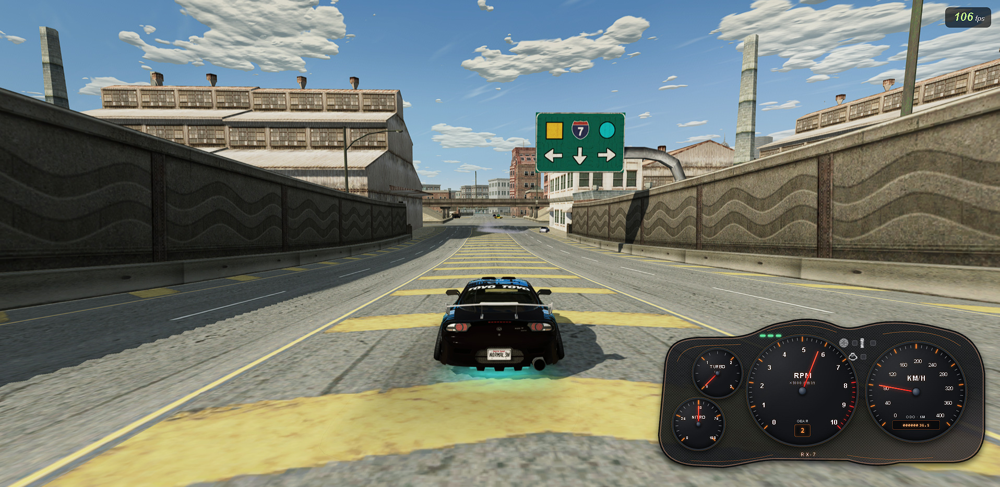
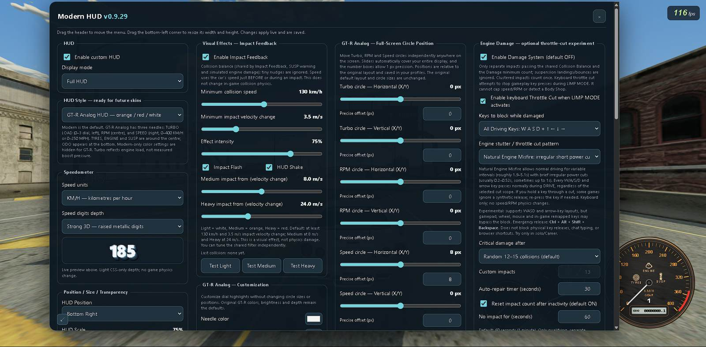

# NFSU2.xyz Modern HUD

**Current version: v0.9.77 — Five HUD Styles (Chromium + Firefox)**

A free, unofficial community browser extension for [NFSU2.xyz](https://nfsu2.xyz). Customize your dashboard and see live driving data using the game's read-only Car Feed without modifying game files, game physics, or 3D rendering.

> **Independent fan project.** Not affiliated with, approved by, or endorsed by NFSU2.xyz. The extension is designed for desktop browsers; some indicators and collision effects are estimates from limited telemetry. Full live-play testing on every browser and hardware configuration is still ongoing.

## What's new since v0.9.31?

**Three brand-new analog HUD styles** join the existing Modern and GT-R dashboards: **Toyota Corolla Retro (AE86-inspired)**, **Honda Civic Si (EM1-inspired)** and **Mazda RX-7 FD**.

- **Toyota Corolla Retro:** classic connected instrument cluster, mechanical GEAR and ODO animation, integrated warnings.
- **Honda Civic Si:** ivory-faced dials, combined Nitro/Turbo instrument, RPM-based **VTEC simulation at 5,600 RPM**, green shift-ready LEDs and rolling GEAR/ODO.
- **Mazda RX-7 FD:** asymmetric carbon instrument housing, independent Turbo/Nitro/RPM/Speed instruments, single KM/H or MPH scale and green shift guide.
- **Custom keyboard shortcuts for TKL / laptop keyboards:** rebind Menu, HUD Toggle and SAVE ALL in the HUD menu or extension popup; **Ctrl + Alt + M** always opens or closes the menu.
- **Expanded analog customization:** independent per-style size/X/Y controls, larger HUD scale range, and zero-based position defaults. Existing saved positions are migrated automatically.
- **Firefox menu compatibility fix:** improved settings styling and operation under strict CSP configurations.
- **Existing HUD improvements:** Modern HUD RPM '10' label no longer overlaps COILOVER; GT-R Analog gains rolling GEAR digits.

For full changes, read [v0.9.77 Release Notes](RELEASE_NOTES_v0.9.77.md) and [CHANGELOG](CHANGELOG.md).

## Screenshots

### Honda Civic Si — new in v0.9.73

### Mazda RX-7 FD — new in v0.9.73

### GT-R Analog HUD in-game

### Resizable multi-column settings menu

### Modern Digital HUD in-game

*These are real screenshots supplied by the project owner. The settings screenshot shows the v0.9.29 menu; v0.9.73 retains the responsive multi-column feature.*

## Features

### Five implemented HUD styles

- **Modern Digital HUD:** speed, RPM, nitrous, gear, shift indicator, turbo/engine-load visualization, and optional warning symbols; flexible colors, layouts and transparency.
- **GT-R Analog HUD:** three circular gauges (Turbo Load / RPM / Speed), gear and warning indicators, plus a compact odometer in the speed dial.
- **Toyota Corolla Retro:** AE86-style classic analog cluster with roll GEAR, rolling ODO and status indicators.
- **Honda Civic Si:** carbon chassis, white analog dials, Nitro/Turbo dual gauge, simulated VTEC and shift LEDs.
- **Mazda RX-7 FD:** asymmetric carbon cluster, independent analog Turbo/Nitro gauges, RPM, Speed and warning lights.
- **Speed units:** KM/H and MPH. Digital speed is not capped at the analog gauge's displayed maximum.
- **Customization:** positions, scale, visibility, display mode, performance settings, dashboard theme and color profiles.
- **Warnings:** tyre slip/traction, engine redline/misfire, suspension/impacts, estimated braking events. Some warning states are derived from telemetry rather than true manufacturer sensors.
- **Limp Mode (optional):** simulated damage and repair with optional throttle/input restriction; does not modify vehicle performance in game memory or physics.
- **Save and transfer settings:** local active settings plus up to 25 custom profiles, import/export profile JSON. **Profile JSON does not export car mileage.**

### Odometer — important behavior

Mileage is **estimated from speed and elapsed time** while driving, not taken from the original game's permanent odometer. It is stored **locally in your browser extension**, independently from NFSU2.xyz saves. Choose your current **car model manually**; the extension does not detect it automatically. Two different owned cars of the same model **share one mileage total**. Selection of the last car is restored when storage and the installed extension identity are preserved.

- Example display: `00000032.1` means 32 km + 100 metres.
- Autosave at every **0.1 km (100 metres)**, periodic additional saves while driving, and when leaving the tab.
- `Numpad *` and **Save current settings now** save HUD settings **and** odometer data.
- ODO reset affects **only the selected model** and asks for confirmation.
- Maximum representable mileage: **9,999,999.9 km**.
- **Keep the same installed extension folder** when upgrading. A new unpacked installation may receive a different extension ID and cannot see the old installation's data automatically.

## Keyboard shortcuts

**New:** custom rebindable keys for TKL and laptop keyboards, configurable in the HUD menu and extension popup. **Ctrl + Alt + M** is an always-available menu fallback.

| Shortcut | Action |
|---|---|
| **Numpad +** | Open/close HUD settings (customizable) |
| **Numpad −** | Enable/disable the entire custom HUD (customizable) |
| **Numpad `*`** | Save all active settings and odometer totals (customizable) |

Default Numpad shortcuts can be rebound for TKL keyboards; Ctrl + Alt + M remains available for the menu. They do not replace the game's native save function.

## Supported browsers

- **Chromium:** Google Chrome, Microsoft Edge, Brave, Opera / Opera GX, Vivaldi and other compatible Chromium browsers (including Arc where extension loading is supported).
- **Mozilla Firefox:** Firefox 140+; temporary developer installation unless a Mozilla-signed extension is provided.

Use the matching folder from the package: `NFSU2-HUD-Chromium` or `NFSU2-HUD-Firefox`.

## Install / upgrade

1. Download the **v0.9.77 ZIP** from [Direct download](downloads/NFSU2_Modern_HUD_v0.9.77_MultiBrowser.zip), and extract it.
2. **For upgrades**, replace the files within your *existing installed extension folder* instead of loading the updated code from a different folder. Back up/export your settings first.
3. Reload the extension in your browser's extension manager, then refresh NFSU2.xyz.
4. Press `Numpad +` to customize, choose a car model under **Odometer — Mileage by Car**, and use `Numpad *` to save all.

Detailed instructions: [INSTALLATION.md](INSTALLATION.md).

## Privacy, safety and limitations

- No game asset editing, direct game-physics modifications, or game-file patching.
- The extension asks for the browser's `storage` permission and runs on `nfsu2.xyz` / `www.nfsu2.xyz`.
- Settings and ODO data reside in the extension's local browser storage; they do **not** automatically sync between browsers, devices, or game profiles.
- Custom HUD profiles include display settings, **not** stored mileage.
- Car Feed data may be stale, missing, or imperfect. Damage, turbo load, ABS/traction and severe-stop detection are not guaranteed direct mechanical telemetry.
- Optional Limp Mode input restriction can temporarily intercept driving controls when enabled; disable it if unwanted. The extension should never be relied on for competitive accuracy.
- Visual effects and update rates are designed to be modest, but live FPS performance varies; test on your own setup.

## Roadmap

- **Future v1.0 ideas (not implemented):** additional original dashboard skins and extended customization.
- Drift Feedback and Rain / Water Drops effects are **not on the active roadmap**.

## Project and attribution

Created as a community dashboard customization project for NFSU2.xyz. All dashboard symbols introduced in recent builds are original SVG designs rather than extracted stock-image assets. No affiliation with the game's developers or publishers is implied.
