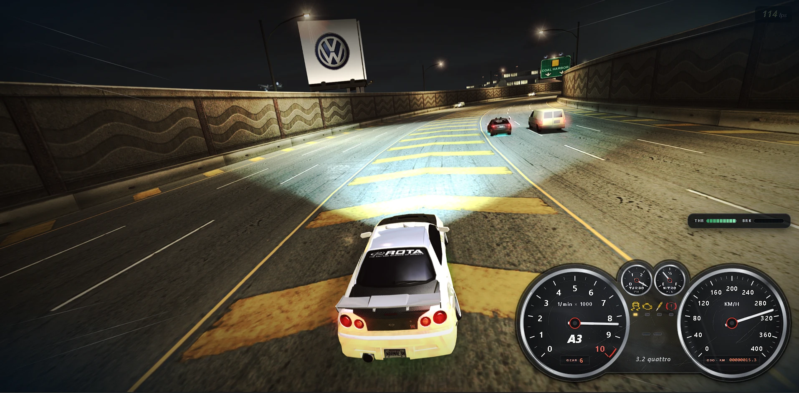

# NFSU2.xyz Modern HUD

**Current version: v0.11.5 — Car-inspired HUDs (Chromium-based desktop browsers)**

A free, unofficial community browser extension for [NFSU2.xyz](https://nfsu2.xyz). Build a custom dashboard around the game's **read-only Car Feed** without editing game files or changing the game's physics or 3D rendering.

> **Independent fan project:** not affiliated with, approved by or endorsed by NFSU2.xyz. Some warnings, turbo, VTEC, mileage and damage signals are estimates or simulations based on the Car Feed; not guaranteed direct game sensors. Live-play behavior and FPS vary by browser and machine.

## Download

**Latest version: v0.11.5.** The release ZIP contains only the `NFSU2-HUD-Chromium/` extension folder.

- **[Download Latest — Chromium ZIP](https://github.com/N0rMal3NNN/NFSU2-Modern-HUD/raw/refs/heads/main/downloads/NFSU2_Modern_HUD_LATEST_Chromium.zip)** — permanent link to the newest release.
- **[Choose Version — Version Archive](DOWNLOADS.md)** — numbered builds, including older releases.
- **[Installation & Upgrade Guide](INSTALLATION.md)** — important for keeping locally saved settings and odometer values.

**Do not use the green GitHub `Code → Download ZIP` button** to install the extension: it downloads the whole repository, including multiple old release packages. Use **Download Latest** above.

## v0.11.5 — Cigarette, Helmet View & Windshield Glass

The latest update adds optional immersive **cockpit overlays**, all configurable in the in-game HUD settings. They are visual effects only; the game files, vehicle physics and Car Feed remain unchanged.

- **3D Cigarette:** Enable/disable (OFF by default), position (bottom-left, bottom-center or bottom-right), size **50–150%**, animated smoke ON/OFF and amount **0–100%**, ember puff effect, optional smoke bending with driving speed, and display **in front of or behind the HUD**. Includes a **7-second preview**.
- **Helmet View:** Choose **GT Full-Face** or **Open-Face Sport**. Helmet ON/OFF (OFF by default), opacity **0–100%**, opening size **90–130%**, layer order (in front of/behind the HUD), impact shake ON/OFF and intensity **0–100%**, and a shake preview.
- **Windshield Glass:** Optional full-screen reflection, dust, wiper traces and sun strip (custom color), plus impact cracks and a Limp Mode shattered-glass effect. Visibility protection keeps the center of the screen clearer; individual effects have separate controls. Windshield Glass is OFF by default.
- **TYRES warning sensitivity:** **10% more slip/spin than in v0.11.4**, on top of the earlier +5% change (total threshold multiplier **×1.155** vs the slider). The default **3.4 m/s** slider triggers at **3.927 m/s** rather than 3.57 m/s. Applies to lateral slip, wheelspin and one-wheel extreme slip, in every HUD including Standalone. Brake/ABS logic is unchanged.
- **Chromium only:** Google Chrome, Edge, Brave, Opera / Opera GX, Vivaldi and compatible Chromium-based desktop browsers.

The cigarette and helmet appear while driving with a live Car Feed and are hidden when paused or inactive. Their visual order can be customized. More details: [v0.11.5 Release Notes](RELEASE_NOTES_v0.11.5.md).

### Cigarette overlay — cockpit gameplay

### Helmet View — cockpit gameplay

## v0.10.7 — RX-7 layout, dial numbers and status lamp fixes

- **RX-7:** warning icons now use an aligned two-by-two layout around the RPM dial (TYRES/ENGINE on the left, SUSP/Handbrake on the right). Icons and lamps are 10% larger, with clear space around the gauges.
- **Dial readability:** numeric tick labels have been adjusted across the analog HUDs, including RX-7, GT-R, Corolla, Civic, Audi, Nissan, Evo/STi and Supra/RX-8, in KM/H and MPH views.
- **GT-R and Corolla:** TYRES/ENGINE/SUSP/HAND text captions are replaced by glowing warning lamps; the Modern Digital HUD retains its captions.
- **Strict-CSP compatibility:** improved gauge rendering, GEAR/ODO positioning and menu styling (introduced in v0.10.5).
- The Pedals HUD, Vignette, independent Status HUD, odometer, shortcut customization and Limp Mode remain available.

**Earlier v0.10.7 screenshots are retained.** Full details: [v0.10.7 Release Notes](RELEASE_NOTES_v0.10.7.md).

## Feature highlights since public v0.9.77

- **Four more dashboard styles** (nine total): **Audi A3 / TT**, **Nissan 350Z / Infiniti G35**, **Mitsubishi Evo VIII / Subaru WRX STi**, **Toyota Supra / Mazda RX-8**. Each shared dashboard offers model-specific variants; automatic selection is linked to the car manually selected in the odometer menu.
- **Honda Civic overhaul:** reworked **EP3-inspired** cluster with cream dials, deep rings, a revised housing and simulated VTEC indicator. Existing Modern, GT-R, Corolla and RX-7 styles remain available.
- **Realistic 3D-style Glass overlay** on analog clusters: adjustable reflections, subtle wear and visual depth, with a visibility slider. **GT-R Housing** optionally wraps around the instruments.
- **Colors & Materials for analog skins:** customize needles, numbers/ticks, redline, ODO text/background, housing, dial face and materials (Matte, Satin, Glossy, Chrome, Brushed Metal, Carbon Fibre and Leather). Each style has its own saved choices.
- **Standalone Status HUD:** independent TYRES / ENGINE / SUSPENSION panel with angled alert lights, horizontal/vertical layout, custom frame/background/light colors, opacity, X/Y and scale. It works while the main speedometer is turned off.
- **Independent Pedals HUD:** live throttle and brake bars, with independent, under-speedometer and within-Status-HUD placements; optional horizontal/vertical layout, scale, position and colors.
- **Handbrake (Space) status:** fourth warning symbol in all nine speedometer styles and Standalone HUD. The lamp follows the **Space key while driving**, not a direct Car Feed handbrake sensor; it can be hidden in the Show section.
- **Screen Shake / collision-feedback improvements:** light impacts can visibly shake the HUD; shake also affects visible Standalone and Pedals panels; diagnostics show what occurred; optional override for Windows/browser **Reduce Motion** settings.
- **Speed Sensation:** optional **corner-darkening Vignette** with adjustable intensity, alongside the existing peripheral speed streaks and optional blue fog.
- **Limp Mode:** improved independent status handling and Engine Misfire simulation (**55% chance of a 1.5-second cut**; other cuts keep the existing shorter duration pattern).
- **Usability:** searchable/categorized settings, ODO digit-roll animation across styles, adjusted analog needle proportions, improved warning icon sizes and shift indicators, and independent panel keyboard shortcuts.

For details, see **[v0.10.7 Release Notes](RELEASE_NOTES_v0.10.7.md)**, [v0.10.4 release notes](RELEASE_NOTES_v0.10.4.md) and [Changelog](CHANGELOG.md).

## Previous gameplay screenshots — seven supplied by the project owner

These are **real NFSU2.xyz gameplay screenshots**, not generated/mock-up imagery. Images are copied directly from the owner-provided files.

### Audi TT — drift gameplay

### Mitsubishi Lancer Evolution VIII — white cluster

### Nissan 350Z — cockpit driving

### Infiniti G35 — drift gameplay

### Toyota Supra — analog cluster

### Audi A3 — Pedals HUD and handbrake indicator

### Audi A3 — night racing

## HUD styles inspired by real cars

| HUD style | Highlights |
|---|---|
| **Modern Digital** | Digital speed, RPM, nitrous, gear, shift and flexible theme colors |
| **GT-R Analog** | Classic three-dial Turbo / RPM / Speed dashboard, optional fitted housing and compact ODO |
| **Toyota Corolla Retro** | Retro linked instruments, rolling GEAR/ODO and warning indicators |
| **Honda Civic (EP3-inspired)** | Cream-faced three-instrument cluster, integrated Nitro/Turbo, VTEC simulation and shift indicators |
| **Mazda RX-7 FD** | Asymmetric rotary-inspired cluster with dedicated Turbo and Nitro instruments |
| **Audi A3 / TT** | Two large dials and upper Turbo/Nitro gauges; model-dependent badge and ring/needle styling |
| **Nissan 350Z / Infiniti G35** | Three-dial contoured housing; model-specific materials, needles and LCD palette |
| **Mitsubishi Evo VIII / Subaru WRX STi** | Evo white/red or STi blue/gold instrument faces and slim central gauge strip |
| **Toyota Supra / Mazda RX-8** | Deep paired dials; Supra analog look or RX-8 integrated digital speed readout |

A shared style may include an **Auto / vehicle-specific variant** selector. The odometer model is chosen manually; the extension does not read the car identity directly from Car Feed.

## Independent panels and visual customization

- **Standalone Status HUD:** `Ctrl + Alt + N` or `Numpad /` toggles its own ON/OFF state. Configure layout, X/Y position, scale, colors and transparency separately from the main speedometer.
- **Pedals HUD:** optional THR / BRK live bars. Can be displayed independently, below the custom speedometer, or inside the Standalone Status HUD. Uses available throttle/brake Car Feed signals, with engine load as fallback for throttle.
- **Handbrake icon:** lamp lights when `Space` is held during active driving. This is **keyboard tracking**, not physical handbrake telemetry; remapped controller/steering-wheel handbrakes are not detected by it.
- **Glass and materials:** analog styling is per HUD, and performance depends on graphics settings. Modern HUD has its own digital theme controls.
- **Collision effects:** visual feedback (flash, warnings and shake) is estimated from available events / speed change. Shake may be configured to work even with system Reduce Motion enabled.

## Odometer — important

- Estimated from vehicle speed and elapsed driving time; **not the native game's odometer**.
- Choose a car model manually. Mileage is stored locally **per model**, not per owned vehicle: two copies of the same model share a total.
- Stored in the extension's local browser storage; **not included in the game's cloud save or settings JSON export**.
- Displays tenths of a kilometre (`00000032.1` = 32.1 km), autosaves each 0.1 km / 100 m with additional periodic saves, and rolls individual digits across HUD styles.
- Saving settings with `Numpad *` also saves local odometer data. Reset is per selected model and requires confirmation.
- To preserve saved mileage, **replace files inside the same existing unpacked extension folder**, then reload; do not uninstall/reinstall in a different folder.

## Keyboard shortcuts

| Default key | Action |
|---|---|
| `Numpad +` | Open / close the settings panel; may be rebound |
| `Ctrl + Alt + M` | Always-available fallback to open / close settings |
| `Numpad -` | Turn the main custom HUD ON / OFF; may be rebound |
| `Numpad *` | SAVE ALL settings + odometer; may be rebound |
| `Ctrl + Alt + N` or `Numpad /` | Turn the Standalone Status HUD ON / OFF |

Custom bindings for the main three actions support **tenkeyless (TKL) and laptop keyboards** via the HUD settings menu or extension popup.

## Supported desktop browsers

- **Supported:** Google Chrome, Microsoft Edge, Brave, Opera / Opera GX, Vivaldi, and other compatible Chromium-based desktop browsers.

The ZIP contains **only `NFSU2-HUD-Chromium/`**. Install it in a compatible Chromium-based desktop browser. See the [installation guide](INSTALLATION.md).

## Privacy, safety and limitations

- Uses the public/read-only Car Feed and extension-local UI / storage. No changes to game assets, game memory or in-game physics.
- Collision, turbo, tyre, suspension and engine-warning indicators can be approximations rather than real ECU/mechanical sensor values.
- Optional Limp Mode may temporarily intercept driving input on your own browser when enabled; it does not change the game's physical simulation.
- Speed Sensation, Glass and collision effects may affect FPS on some hardware; tune intensity/performance in Settings.
- Saved settings and ODO data do not automatically sync across browsers, devices, extension identities, or game accounts.

## Project

Built by the community for NFSU2.xyz. This is an independent, unofficial fan-made dashboard customization project. All gameplay screenshots in this README were provided by the project owner.