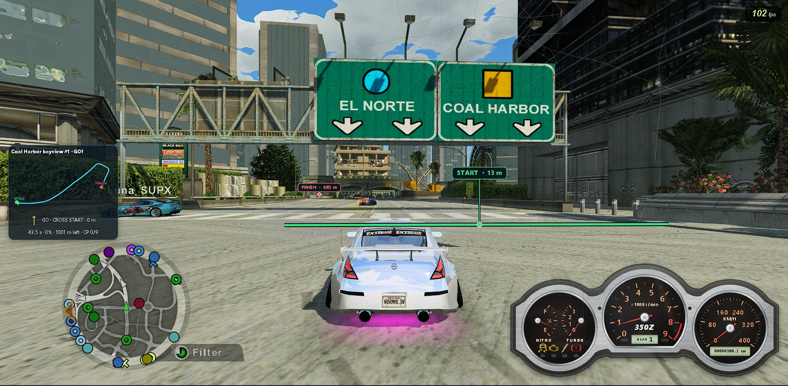
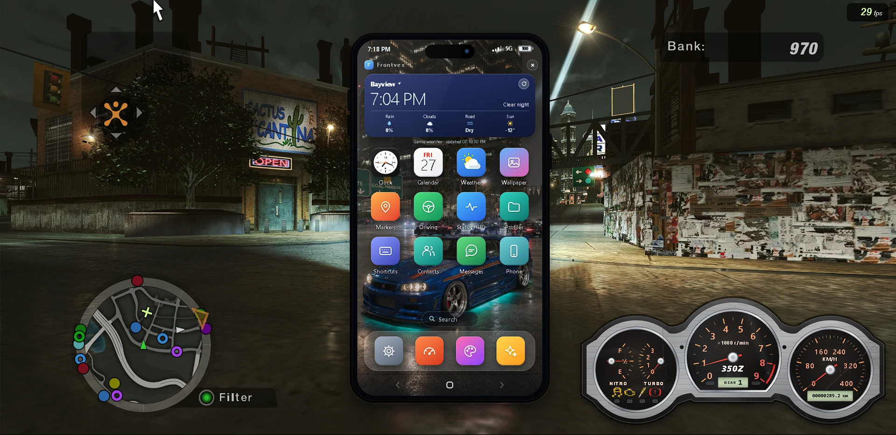
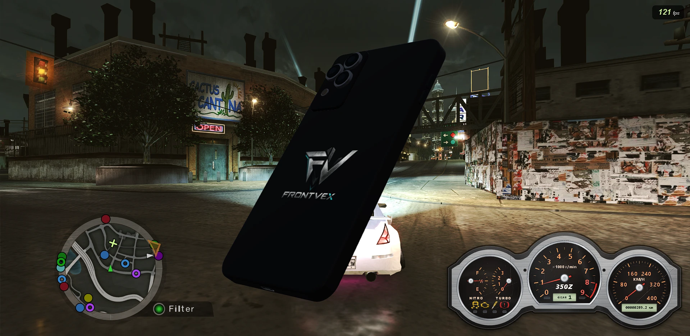
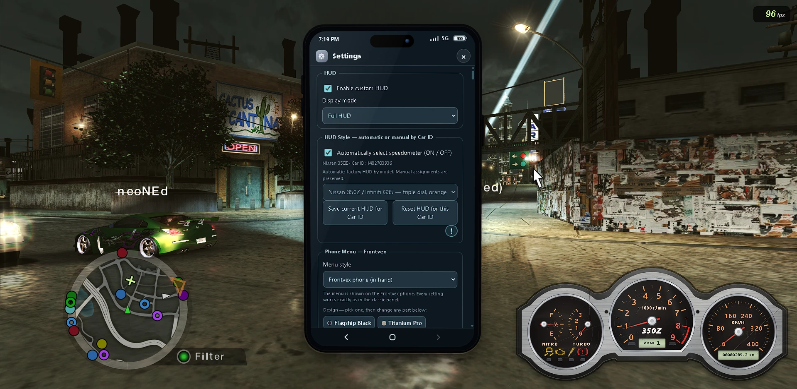
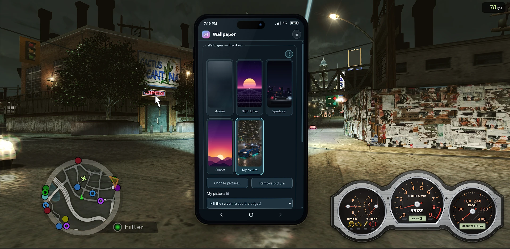
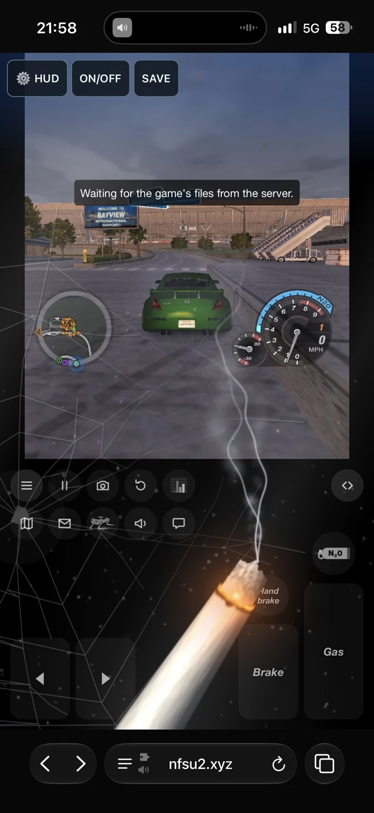

# NFSU2.xyz Modern HUD

> **Desktop v0.11.66 BETA — Frontvex Racing & My Car is available.** [Release notes](RELEASE_NOTES_v0.11.66.md).

> **Frontvex Phone, GPS & Automatic Speedometer — Desktop BETA.** [Read the full release notes](RELEASE_NOTES_v0.11.58.md). Includes a customizable 2D/3D in-game phone, automatic HUD selection, GPS markers and optional Frontvex communication. The new mobile build is not ready; Userscript BETA 5 remains available.
> Special thanks to [OBD Gaming](https://www.facebook.com/overbudgetgg) for the idea behind the Frontvex in-game phone. Frontvex online services are still in a limited server beta.

**Current desktop version: v0.11.66 BETA (Chromium) · Mobile: Userscript BETA 5 (iPhone & Android, based on v0.11.26)**

A free, unofficial community browser extension for [NFSU2.xyz](https://nfsu2.xyz). Build a custom dashboard around the game's **read-only Car Feed** without editing game files or changing the game's physics.

> **Independent fan project:** not affiliated with, approved by or endorsed by NFSU2.xyz. Some warnings, turbo, VTEC, mileage and damage signals are estimates or simulations based on the Car Feed; not guaranteed direct game sensors. Live-play behavior and FPS vary by browser and machine.

## Download

**Latest desktop version: v0.11.66 BETA.** The desktop release ZIP contains only the `NFSU2-HUD-Chromium/` extension folder.

- **[Download Latest — Chromium ZIP](https://github.com/N0rMal3NNN/NFSU2-Modern-HUD/raw/refs/heads/main/downloads/NFSU2_Modern_HUD_LATEST_Chromium.zip)** — permanent link to the newest release.
- **[Choose Version — Version Archive](DOWNLOADS.md)** — numbered builds, including older releases.
- **[Installation & Upgrade Guide](INSTALLATION.md)** — important for keeping locally saved settings and odometer values.
- **📱 [Download Userscript BETA 5 — phones & tablets](downloads/NFSU2_Userscripts_BETA_5.zip)** — iPhone: Safari + Userscripts (move the `.js` file into the Userscripts folder) · Android: Edge + Tampermonkey (import the ZIP). One universal file. See [Phone install](INSTALLATION.md#phones-and-tablets-userscript-beta-5).

**Do not use the green GitHub `Code → Download ZIP` button** to install the extension: it downloads the whole repository, including multiple old release packages. Use **Download Latest** above.

---

## v0.11.66 BETA — Frontvex Racing & My Car

Create custom Free Roam tracks, share them with friends and race in Solo Test or friendly PvP 1v1. Both players must stop behind START for two seconds within 5 m of each other before the automatic countdown.

- **Racing:** configurable navigation HUD, 3D gates and sequential checkpoints, synchronized countdown, live opponent position, finish statistics and local career records.
- **My Car:** performance tests with automatic nitrous detection and manual turbo selection, per-car records, driving statistics and independent trip reset.
- **Jump Monitor:** optional live airtime HUD and completed jump statistics.
- **Privacy:** local race and vehicle records; direct peer-to-peer racing with registered friends when a connection succeeds. Cross-network PvP testing remains pending.

[Full release notes and all screenshots](RELEASE_NOTES_v0.11.66.md)

### How to start a PvP 1v1 race

1. **Register and connect:** Both players need the latest public desktop extension (v0.11.66 for this release), a registered Frontvex account/number and enabled communication. Enter Free Roam and make sure both players are online and can connect directly.
2. **Add a friend:** Open the Frontvex phone → **Contacts**, find your friend by their Frontvex number, send a friend request and have them accept it.
3. **Create a track:** Open **Racing → Create Track**, enter a track name, choose **Set START & Record**, drive the route, choose **Set FINISH**, and press **Save Track**.
4. **Share the track:** In **My Tracks**, select the saved track, select your online friend and send it using **Share Race Track**.
5. **Accept the shared track:** Your friend opens **Racing → Invitations**, previews the route and selects **Accept & Save Track**. Wait for the sender to receive confirmation that the track has been saved. If the recipient deletes the track, share it again.
6. **Challenge your friend:** With the same track and friend selected, press **Challenge Friend**. This is a separate PvP invitation; sharing the track alone does not start a race.
7. **Accept the race:** Your friend receives a Racing notification (sound/pop-up subject to notification settings), opens **Invitations**, and presses **Accept Challenge**. The race route, Racing HUD and enabled 3D markers load automatically for both players.
8. **Stage at START:** Both cars must be behind the green START line, within the staging zone, facing along the route, stationary and **no more than 5 metres apart in 3D** (side by side, one behind the other, or diagonally).
9. **Get ready automatically:** Remain stationary for **2 uninterrupted seconds**. Once both players are ready, within range and synchronized, the countdown starts automatically: **5 – 4 – 3 – 2 – 1 – GO!** No manual Ready or Start Countdown button is needed.
10. **Race and finish:** Follow the route, cross the white checkpoints in order, then cross the red FINISH line. The finish HUD shows your placement, race time, maximum and average speed, nitrous activations and distance. Results are saved in **Race History**.

**Race rules:** Burnouts using SPACE + W are allowed during the countdown, but crossing START before GO triggers a false start. Leave **Enable Start With Pause (Test Mode)** disabled for normal races. Keep the game active and the P2P connection working. A successful direct connection is required; cross-network PvP remains a beta feature. Solo Tests do not count as PvP wins or losses.

---

## v0.11.60 BETA — Frontvex Software Update

The Software Update app in the Frontvex phone displays the installed and latest public desktop version, release date and last successful check.

- Automatic version checks when the game opens and every 30 minutes, with shared cached results between game tabs.
- Manual **Check for Updates**, with a short request cooldown.
- A software update notification and sound (subject to notification settings and browser audio permissions), once per newly detected release per browser profile.
- A red update badge stays on the app icon while a newer version is available.
- **Download Update** opens the official Latest Chromium ZIP; **What's New** opens the changelog.
- No Frontvex account required. Version metadata is read from the project's GitHub repository; no account information is sent to the update endpoint.
- Updates are downloaded and installed manually. If GitHub is unreachable, the app reports the unsuccessful check rather than claiming the installation is current.

The update channel is for public desktop Chromium builds only. Mobile Userscript BETA 5 remains available separately.

### How to check for and install an update

1. Open the Frontvex phone → **Updates (Software Update)**.
2. Select **Check for Updates** to check immediately; there is no need to wait 30 minutes. The app also checks automatically when initialized and every 30 minutes while the game page is open (subject to cached results, connectivity and browser scheduling).
3. If a newer public version is available, select **Download Update** and save the official Chromium ZIP. **What's New** opens the changelog. A notification and sound may appear if allowed by your settings/browser; the Updates icon displays an exclamation badge.
4. Close the game tab, extract the ZIP, and copy the updated extension files over the existing unpacked extension folder. Keep the original folder path and do not uninstall the extension.
5. Open your browser's extension manager, press **Reload** for the existing extension, then reopen/refresh NFSU2.xyz. Verify the installed version in Software Update and check that saved settings and mileage are present.

The app notifies you about new public releases; it does not install them automatically. No Frontvex registration is required for the update check.

---

## v0.11.58 BETA — Frontvex Phone, GPS & Automatic Speedometer (Desktop)

A major desktop update that brings a customizable smartphone interface into NFSU2.xyz, combining dashboard customization, game telemetry, driving tools and optional player communication in one place.

### Frontvex Phone — 2D & 3D

- **Phone interface:** a home screen with app icons, clock, calendar, search and back/forward navigation. The classic HUD settings panel remains available as an alternative.
- **3D design:** rotate the phone through 360° to view its front, sides and rear, with a triple-camera design, flash, Frontvex logo, physical button details and USB-C port.
- **Appearance:** customize the frame, body, bezel, accent colors, materials, case, screen cutout, glare and opening animation. Optional sunlight effect.
- **Size and placement:** adjust the phone scale and choose its screen position, including corner and centered layouts.
- **Wallpaper:** select a preset or use your own image, with image-fit and dimming controls. Adjust app icon and weather card sizes.
- **Apps and shortcuts:** access Settings, Cars HUD, Colors & Materials, Effects, Driving, Status HUD, Profiles, Shortcuts, Markers, Weather, Contacts and Messages directly from the phone.

**Special thanks to [OBD Gaming](https://www.facebook.com/overbudgetgg) for the inspiration behind the Frontvex in-game phone. Your idea helped bring this feature to life!**

### Automatic Speedometer & Car Profiles

- **Automatic ON:** selects a matching dashboard style using the vehicle model reported by the game's Car Feed.
- **Automatic OFF:** choose a HUD style manually for each owned car using its unique Car ID. Different cars of the same model can have different dashboard styles.
- **Personal assignments:** switching between automatic and manual mode retains your saved manual choices. Cars without a stable Car ID use the model-based fallback.
- **Odometer:** mileage continues to be recorded separately for each vehicle model.

### Game Weather & Time

- Displays the in-game time and weather conditions using the read-only View Feed.
- Shows rain, cloud conditions, road conditions and sunlight information when available.
- Weather information refreshes when opening the phone and can also be refreshed manually.
- Select a city label manually; the feature does not use real-world GPS or automatically identify your city.

### GPS & Pin Markers

- Save locations in the game world as personal markers and organize them with city labels.
- Record your driving speed at saved marker locations.
- Share a selected GPS pin with a Frontvex friend and save received pins to your own marker collection.
- Use received markers to record your own speed at the same location. Nearby received pins are grouped by location.

### Frontvex Contacts & Player Communication (Limited Server BETA)

- **My Profile:** choose a local username and reserve a custom FVX phone number. Each account uses a cryptographic FVX identity.
- **Friends:** send and accept friend requests, view your contacts and see online/offline presence. Local blocking is available.
- **Private messages:** direct peer-to-peer WebRTC communication, pending delivery, delivery/read receipts and manually shared GPS pins.
- **Inbox:** see the sender, latest message, timestamp and unread count. Conversations use separate incoming and outgoing message bubbles.
- **Message history:** configurable local history limit and centralized deletion controls with selection and confirmation.
- **Connection management:** automatic connection refresh after successful registration or re-registration, manual Reconnect / Renew, and an independent communication enable/disable setting. Ordinary renewal is designed to preserve an active connection.

### Notifications & Sounds

- Alerts for friend requests, incoming messages, shared GPS pins and friends coming online.
- Five selectable notification sounds, adjustable volume and test alerts.
- Optional message previews, Do Not Disturb and persistent unread badges.
- Notifications appear as a phone banner or a bottom-right toast; Frontvex popup notifications have a four-second display duration.

### Registration & Privacy

- Official Cloudflare Turnstile verification opens in a popup over the game on supported Chromium browsers, without opening a new tab or navigating away from the game.
- Standard FVX number reservations expire after 15 days without successful renewal.
- Usernames, private keys, contacts and message history are stored locally. The registration service stores the information required for number reservation and account authentication.
- Direct WebRTC communication depends on network compatibility; there is no central message history or relay service.
- Frontvex communication is optional and currently operates in a restricted server BETA. Access is not guaranteed for every user. The HUD, customization and local driving features do not require an FVX account.

### Settings & Everyday Use

- Compact help icons provide contextual explanations without filling the settings menu with long descriptions.
- Search includes help text; important warnings and live status remain visible.
- Local HUD profiles, saved settings and per-model odometer records remain available when upgrading in the same extension folder and browser profile.

### Frontvex Phone — Screenshots

  
  

  
  

*Frontvex phone home screen, 3D rear design, automatic speedometer and wallpaper customization.*

Full details: [v0.11.58 Release Notes](RELEASE_NOTES_v0.11.58.md). The new mobile build is not ready. The HUD works without Frontvex registration; communication access remains restricted during server beta.

---

## v0.11.26 — New HUD Styles, Material Library, Drink and Speed Sensation Update

Cumulative update since v0.11.10.

- **Three new HUD styles:** Honda S2000 (AP1) digital LED cluster, Honda Integra Type R (DC2) twin dial, and Subaru Impreza RS twin dial with a centre display (gear, NITRO, odometer, warning lights) and an analogue TURBO gauge.
- **Material library:** 23 extra needle, bezel and dial-background textures in Colors & Materials for all analog styles (not the Modern HUD).
- **Drink (optional, default OFF):** a sip of beer or whisky from a gloved hand, with an optional police warning, drunk look and controls effect.
- **Windshield glass:** cracks on the side of the impact (with a Flip option), clearly visible dust after dirt and grass that lasts 20 s.
- **Handbrake lamp:** follows the game's own handbrake value.
- **Speed Sensation fix:** streaks, Blue Fog and vignette follow the live Car Feed, also work with the main HUD off, and the menu has a live status line.
- **TYRES lamp:** reacts only to real wheel slip; the sudden-brake estimate and its slider were removed.

Full details: [v0.11.26 Release Notes](RELEASE_NOTES_v0.11.26.md).

---

## 📱 Userscript BETA 5 — iPhone and Android

The v0.11.26 HUD for touch devices, in **one universal userscript** for iPhone / iPad and Android. It is a **BETA**.

**iPhone / iPad (Safari + Userscripts):**

1. Install **Userscripts** from the App Store and open the app once.
2. Download the **`.js`** file (or the ZIP, extracted in Files).
3. **Move** the `.user.js` file into the Userscripts folder.
4. Enable Userscripts in **Settings → Safari → Extensions** and allow it for `nfsu2.xyz`.
5. Open `nfsu2.xyz` in Safari.

**Android (Microsoft Edge + Tampermonkey):**

1. Install **Microsoft Edge**.
2. Open Edge's menu → **Extensions**, find **Tampermonkey** and install it.
3. Enable Tampermonkey and **Allow User Scripts**.
4. Download the **ZIP** file (no need to extract it).
5. Open Tampermonkey → **Dashboard → Utilities → Import from file**.
6. Select the ZIP file and import it.
7. Open `nfsu2.xyz` in Edge.

Once you are in the game, tap the small **⚙** button to access the HUD settings. Other Android browsers and managers are not tested.

**Direct links:** [BETA 5 ZIP](https://github.com/N0rMal3NNN/NFSU2-Modern-HUD/raw/refs/heads/main/downloads/NFSU2_Userscripts_BETA_5.zip) · [`.user.js` file](https://github.com/N0rMal3NNN/NFSU2-Modern-HUD/raw/refs/heads/main/userscript/NFSU2_Modern_HUD.user.js)

**BETA 5 was tested on real phones, on both iPhone and Android, and works.** BETA 4 was tested by the project owner on iPhone and Android and by **RacerXC** on Android.

- **New in BETA 5 (v0.11.26.5):** Honda S2000, Integra Type R and Impreza RS HUD styles, the material library, Drink (with a **DRINK** button in the ⚙ launcher while it is enabled), the Speed Sensation fix, the cleaned-up TYRES lamp, and fullscreen overlays for the new effects.
- **One small ⚙ button** — nothing else covers the screen; move it with your finger (Portrait and Landscape positions are remembered separately).
- **HUD, ON/OFF, DRINK and SAVE stay hidden until you press the ⚙.**
- **Windshield cracks are limited to 2 on screen by default** (choose 2, 3, 4 or Standard in the menu).
- **Android / Car Feed Debug** section in the menu: a local-only diagnostic report you can copy if something does not work.

  
  

*iPhone (Safari + Userscripts): the HUD at the bottom right (left) and the Cigarette and Windshield Glass effects (right). These screenshots were supplied by the project owner and come from an earlier BETA build; in BETA 4 and BETA 5 only the small ⚙ button is shown until you tap it.*

The userscript keeps its own settings and odometer; they are not shared with the desktop extension. Step-by-step instructions for iPhone and Android: [Phones and tablets: Userscript BETA 5](INSTALLATION.md#phones-and-tablets-userscript-beta-5). Release information: [v0.11.26 Release Notes](RELEASE_NOTES_v0.11.26.md#userscript-beta-5-for-phones-and-tablets).

Thanks to **RacerXC** — the first Android beta tester!

---

## v0.11.10 — Windshield, HUD Position and Menu Keyboard Update

Cumulative update since v0.11.7 (versions v0.11.8, v0.11.9 and v0.11.10).

- **HUD X / Y Position (v0.11.10):** move the entire speedometer with sliders or precise pixel fields. Every HUD style remembers its own position; a Reset button is included.
- **Standalone Status HUD (v0.11.10):** the TYRES / ENGINE / SUSP panel now appears only during live driving telemetry (not before the game starts, while paused, or after the feed stops).
- **Menu keyboard input (v0.11.9):** typing and editing in the HUD settings fields is handled natively by the browser, without interference from game controls or HUD shortcuts.
- **Independent windshield collision detection (v0.11.8):** cracks use their own impact samples and threshold (default 3.0 m/s, adjustable 3–20 m/s), independent of Impact Feedback, Helmet, suspension and Limp Mode.

Full details: [v0.11.10 Release Notes](RELEASE_NOTES_v0.11.10.md).

---

## v0.11.7 — Cigarette, Helmet & Driving Immersion Update

This update introduced customizable cockpit effects and improved tyre slip detection for a more immersive driving experience.

### 🚬 Cigarette

- Enable / Disable (OFF by default).
- Glowing ember, ash and animated smoke.
- Three selectable positions: Left, Center and Right.
- Adjustable size (50–150%).
- Adjustable smoke intensity (0–100%).
- Smoke Animation ON/OFF.
- Automatic Ember Puff effect.
- Dynamic smoke movement based on vehicle speed.
- Placement in front of or behind the HUD.
- 7-second preview.

#### Cigarette Preview

### 🏁 Helmet View — 2 Helmet Models

Two selectable helmet models:

- **GT Full-Face Helmet**
- **Open-Face Sport Helmet**

Customization options:

- Helmet ON/OFF (OFF by default).
- Adjustable helmet opacity (0–100%).
- Adjustable visor opening size (90–130%).
- Placement in front of or behind the HUD.
- Shake on Impact ON/OFF.
- Adjustable shake intensity (0–100%).
- Helmet shake preview.
- Automatically hidden when the game is paused.

#### Helmet View Preview

### 🚘 Windshield Glass

- Enable / Disable (OFF by default).
- Customizable windshield reflections.
- Adjustable dust intensity.
- Customizable wiper marks.
- Adjustable sun strip with custom colors.
- Three different windshield crack patterns.
- Dynamic windshield cracks after collisions.
- Shattered windshield during Limp Mode.
- Automatic crack fading.
- Central visibility protection.
- Independent visual effect controls.

### 🔧 Fixed: SLIP Light

- Reworked tyre slip detection using Car Feed telemetry.
- Fixed false SLIP Light activation during sharp cornering without actual tyre slip.
- Improved lateral slip detection.
- Improved wheel spin detection.
- Improved wheel-to-ground contact detection.
- Improved filtering of temporary slip signals.
- Increased slip detection threshold.
- Added real-time tyre slip telemetry diagnostics.
- ABS and braking detection remain unchanged.
- Improvements apply to all HUD styles, including Standalone Status HUD.

All new visual effects are optional and customizable. The game files and vehicle physics remain unchanged.

---

## v0.10.7 — RX-7 Layout, Dial Numbers and Status Lamp Fixes

- **RX-7:** warning icons now use an aligned two-by-two layout around the RPM dial (TYRES/ENGINE on the left, SUSP/Handbrake on the right). Icons and lamps are 10% larger, with clear space around the gauges.
- **Dial readability:** numeric tick labels have been adjusted across the analog HUDs, including RX-7, GT-R, Corolla, Civic, Audi, Nissan, Evo/STi and Supra/RX-8, in KM/H and MPH views.
- **GT-R and Corolla:** TYRES/ENGINE/SUSP/HAND text captions are replaced by glowing warning lamps; the Modern Digital HUD retains its captions.
- **Strict-CSP compatibility:** improved gauge rendering, GEAR/ODO positioning and menu styling (introduced in v0.10.5).
- The Pedals HUD, Vignette, independent Status HUD, odometer, shortcut customization and Limp Mode remain available.

Full details: [v0.10.7 Release Notes](RELEASE_NOTES_v0.10.7.md).

---

## Feature Highlights Since Public v0.9.77

- **Four more dashboard styles (nine total):** Audi A3 / TT, Nissan 350Z / Infiniti G35, Mitsubishi Evo VIII / Subaru WRX STi, Toyota Supra / Mazda RX-8. Each shared dashboard offers model-specific variants; automatic selection is linked to the car manually selected in the odometer menu.

- **Honda Civic overhaul:** reworked EP3-inspired cluster with cream dials, deep rings, a revised housing and simulated VTEC indicator. Existing Modern, GT-R, Corolla and RX-7 styles remain available.

- **Realistic Glass overlay:** adjustable reflections, subtle wear and visual depth, with a visibility slider. GT-R Housing optionally wraps around the instruments.

- **Colors & Materials for analog skins:** customize needles, numbers/ticks, redline, ODO text/background, housing, dial face and materials (Matte, Satin, Glossy, Chrome, Brushed Metal, Carbon Fibre and Leather). Each style has its own saved choices.

- **Standalone Status HUD:** independent TYRES / ENGINE / SUSPENSION panel with angled alert lights, horizontal/vertical layout, custom frame/background/light colors, opacity, X/Y and scale. It works while the main speedometer is turned off.

- **Independent Pedals HUD:** live throttle and brake bars, with independent, under-speedometer and within-Status-HUD placements; optional horizontal/vertical layout, scale, position and colors.

- **Handbrake (Space) status:** fourth warning symbol in all nine speedometer styles and Standalone HUD. The lamp follows the Space key while driving, not a direct Car Feed handbrake sensor; it can be hidden in the Show section.

- **Screen Shake / collision-feedback improvements:** light impacts can visibly shake the HUD; shake also affects visible Standalone and Pedals panels; diagnostics show what occurred; optional override for Windows/browser Reduce Motion settings.

- **Speed Sensation:** optional corner-darkening Vignette with adjustable intensity, alongside the existing peripheral speed streaks and optional blue fog.

- **Limp Mode:** improved independent status handling and Engine Misfire simulation (55% chance of a 1.5-second cut; other cuts keep the existing shorter duration pattern).

- **Usability:** searchable/categorized settings, ODO digit-roll animation across styles, adjusted analog needle proportions, improved warning icon sizes and shift indicators, and independent panel keyboard shortcuts.

For more details:

- [v0.10.7 Release Notes](RELEASE_NOTES_v0.10.7.md)
- [v0.10.4 Release Notes](RELEASE_NOTES_v0.10.4.md)
- [Full Changelog](CHANGELOG.md)

---

## Previous Gameplay Screenshots

Gameplay screenshots supplied by the project owner.

### Audi TT

### Mitsubishi Lancer Evolution VIII — White Cluster

### Nissan 350Z — Cockpit Driving

### Infiniti G35 — Drift Gameplay

### Toyota Supra — Analog Cluster

### Audi A3 — Pedals HUD and Handbrake Indicator

### Audi A3 — Night Racing

---

## HUD Styles Inspired by Real Cars

| HUD Style | Highlights |
|---|---|
| **Modern Digital** | Digital speed, RPM, nitrous, gear, shift and flexible theme colors |
| **GT-R Analog** | Classic three-dial Turbo / RPM / Speed dashboard, optional fitted housing and compact ODO |
| **Toyota Corolla Retro** | Retro linked instruments, rolling GEAR/ODO and warning indicators |
| **Honda Civic (EP3-inspired)** | Cream-faced three-instrument cluster, integrated Nitro/Turbo, VTEC simulation and shift indicators |
| **Mazda RX-7 FD** | Asymmetric rotary-inspired cluster with dedicated Turbo and Nitro instruments |
| **Audi A3 / TT** | Two large dials and upper Turbo/Nitro gauges; model-dependent badge and ring/needle styling |
| **Nissan 350Z / Infiniti G35** | Three-dial contoured housing; model-specific materials, needles and LCD palette |
| **Mitsubishi Evo VIII / Subaru WRX STi** | Evo white/red or STi blue/gold instrument faces and slim central gauge strip |
| **Toyota Supra / Mazda RX-8** | Deep paired dials; Supra analog look or RX-8 integrated digital speed readout |

A shared style may include an **Auto / vehicle-specific variant** selector. The odometer model is chosen manually; the extension does not read the car identity directly from Car Feed.

---

## Independent Panels and Visual Customization

- **Standalone Status HUD:** `Ctrl + Alt + N` or `Numpad /` toggles its own ON/OFF state. Configure layout, X/Y position, scale, colors and transparency separately from the main speedometer.

- **Pedals HUD:** optional THR / BRK live bars. Can be displayed independently, below the custom speedometer, or inside the Standalone Status HUD. Uses available throttle/brake Car Feed signals, with engine load as fallback for throttle.

- **Handbrake icon:** lamp lights when `Space` is held during active driving. This is keyboard tracking, not physical handbrake telemetry; remapped controller/steering-wheel handbrakes are not detected by it.

- **Glass and materials:** analog styling is per HUD, and performance depends on graphics settings. Modern HUD has its own digital theme controls.

- **Collision effects:** visual feedback (flash, warnings and shake) is estimated from available events / speed change. Shake may be configured to work even with system Reduce Motion enabled.

---

## Odometer — Important

- Estimated from vehicle speed and elapsed driving time; not the native game's odometer.
- Choose a car model manually.
- Mileage is stored locally per model, not per owned vehicle: two copies of the same model share a total.
- Stored in the extension's local browser storage; not included in the game's cloud save or settings JSON export.
- Displays tenths of a kilometre (`00000032.1` = 32.1 km).
- Autosaves each 0.1 km / 100 m with additional periodic saves.
- Rolling individual digits across HUD styles.
- Saving settings with `Numpad *` also saves local odometer data.
- Reset is per selected model and requires confirmation.

**To preserve saved mileage, replace files inside the same existing unpacked extension folder, then reload. Do not uninstall/reinstall in a different folder.**

---

## Keyboard Shortcuts

| Default Key | Action |
|---|---|
| `Numpad +` | Open / close the settings panel; may be rebound |
| `Ctrl + Alt + M` | Always-available fallback to open / close settings |
| `Numpad -` | Turn the main custom HUD ON / OFF; may be rebound |
| `Numpad *` | SAVE ALL settings + odometer; may be rebound |
| `Ctrl + Alt + N` or `Numpad /` | Turn the Standalone Status HUD ON / OFF |

Custom bindings for the main three actions support tenkeyless (TKL) and laptop keyboards via the HUD settings menu or extension popup.

---

## 🌐 Supported Browsers

**Desktop extension (Chromium ZIP):**

- Google Chrome
- Microsoft Edge
- Brave
- Opera
- Opera GX
- Vivaldi
- Other compatible Chromium-based desktop browsers

The ZIP contains only `NFSU2-HUD-Chromium/`.

**Phones and tablets (Userscript BETA 5):** iPhone / iPad — Safari + Userscripts; Android — Microsoft Edge + Tampermonkey. BETA 5 was tested on real phones (iPhone and Android) and works. Other Android browsers and managers are not tested.

See the [Installation & Upgrade Guide](INSTALLATION.md).

---

## Privacy, Safety and Limitations

- Uses the public/read-only Car Feed and extension-local UI / storage.
- No changes to game assets, game memory or in-game physics.
- Collision, turbo, tyre, suspension and engine-warning indicators can be approximations rather than real ECU/mechanical sensor values.
- Optional Limp Mode may temporarily intercept driving input on your own browser when enabled; it does not change the game's physical simulation.
- Visual effects may affect FPS on some hardware; tune intensity/performance in Settings.
- Saved settings and ODO data do not automatically sync across browsers, devices, extension identities, userscript managers or game accounts. The phone userscript and the desktop extension keep separate data.

---

## Project

Built by the community for NFSU2.xyz.

This is an independent, unofficial fan-made dashboard customization project. All gameplay screenshots in this README were provided by the project owner.

**Enjoy a more immersive driving experience in NFSU2.xyz!**
