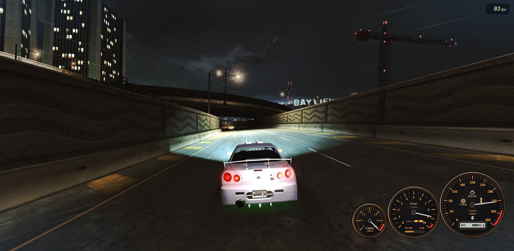
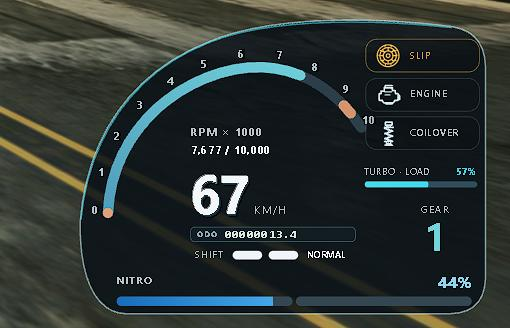

# NFSU2.xyz Modern HUD

**Current version: v0.9.31 — Modern & GT-R Analog HUD (Multi-Browser Edition)**

A free, unofficial community browser extension for [NFSU2.xyz](https://nfsu2.xyz). Customize your dashboard and see live driving data using the game's read-only Car Feed without modifying game files, game physics, or 3D rendering.

> **Independent fan project.** Not affiliated with, approved by, or endorsed by NFSU2.xyz. The extension is designed for desktop browsers; some indicators and collision effects are estimates from limited telemetry. Full live-play testing on every browser and hardware configuration is still ongoing.

## What's new since the previous public release (v0.9.9)?

- **Speed Sensation:** subtle cylindrical / tunnel-style peripheral speed streaks; default activation **190 km/h** (adjustable **140–300 km/h**); optional **Blue Fog** with independent ON/OFF and **0–100% opacity** (default **12%**), plus five-second preview and intensity control. Center view stays mostly clear; respects reduced motion.
- **Impact Feedback:** lightweight white/orange/red peripheral flashes for light/medium/heavy collisions, optional **HUD-only shake**, preview buttons, strength and severity adjustments, and collision diagnostics. No game camera movement.
- **Collision / SUSP improvements:** collision speed default **130 km/h**; adjustable impact gates; more consistent suspension warnings; fallback detection for extremely sudden full stops even when impact telemetry is incomplete. These are heuristics, not authoritative game damage readings.
- **Limp Mode adjustments:** default **30-second repair** and separate **60-second no-impact reset**. Optional simulation remains independent of game physics.
- **GT-R Analog up to 400 KM/H / 250 MPH**, preserving the original dial sizes and alignment; full-screen independent X/Y positioning for Turbo, RPM and Speed gauges (with per-circle reset).
- **Analog customization:** needle, tick and number colors, dial illumination and optional depth; updated vector warning icons (TYRES wheel, ENGINE check-engine, SUSP coilover), repositioned around the speedometer center.
- **Per-model Odometer (ODO):** manual selection of **31 vehicle models**, independent mileage per model, LCD displays in both HUD styles, **0.1 km / 100 m** precision and automatic save on **every 100 m**, with additional periodic/exit saves. Maximum **9,999,999.9 km**.
- **Numpad `*` = Save All:** saves active HUD settings and odometer data without opening the menu; fixed confirmation/read-back behavior and odometer recovery across browser restarts.
- **Better settings panel:** resizable and responsive **1–4 column** layout, controls do not stretch, and dimensions/position persist.
- **Modern HUD layout refinements:** narrower panel, improved RPM / Speed / ODO / SHIFT vertical spacing and **1 px ODO digit spacing** in both HUD styles.

For the detailed change-by-version history, see [CHANGELOG.md](CHANGELOG.md). For update instructions and browser-specific installation, see [INSTALLATION.md](INSTALLATION.md).

## Screenshots

### GT-R Analog HUD in-game

### Resizable multi-column settings menu

### Modern Digital HUD in-game

*These are real screenshots supplied by the project owner. The settings screenshot shows the v0.9.29 menu; v0.9.31 retains the responsive multi-column feature.*

## Features

### Two implemented HUD styles

- **Modern Digital HUD:** speed, RPM, nitrous, gear, shift indicator, turbo/engine-load visualization, and optional warning symbols; flexible colors, layouts and transparency.
- **GT-R Analog HUD:** three circular gauges (Turbo Load / RPM / Speed), gear and warning indicators, plus a compact odometer in the speed dial.
- **Speed units:** KM/H and MPH. Digital speed is not capped at the analog gauge's displayed maximum.
- **Customization:** positions, scale, visibility, display mode, performance settings, dashboard theme and color profiles.
- **Warnings:** tyre slip/traction, engine redline/misfire, suspension/impacts, estimated braking events. Some warning states are derived from telemetry rather than true manufacturer sensors.
- **Limp Mode (optional):** simulated damage and repair with optional throttle/input restriction; does not modify vehicle performance in game memory or physics.
- **Save and transfer settings:** local active settings plus up to 25 custom profiles, import/export profile JSON. **Profile JSON does not export car mileage.**

### Odometer — important behavior

Mileage is **estimated from speed and elapsed time** while driving, not taken from the original game's permanent odometer. It is stored **locally in your browser extension**, independently from NFSU2.xyz saves. Choose your current **car model manually**; the extension does not detect it automatically. Two different owned cars of the same model **share one mileage total**. Selection of the last car is restored when storage and the installed extension identity are preserved.

- Example display: `00000032.1` means 32 km + 100 metres.
- Autosave at every **0.1 km (100 metres)**, periodic additional saves while driving, and when leaving the tab.
- `Numpad *` and **Save current settings now** save HUD settings **and** odometer data.
- ODO reset affects **only the selected model** and asks for confirmation.
- Maximum representable mileage: **9,999,999.9 km**.
- **Keep the same installed extension folder** when upgrading. A new unpacked installation may receive a different extension ID and cannot see the old installation's data automatically.

## Keyboard shortcuts

| Shortcut | Action |
|---|---|
| **Numpad +** | Open/close HUD settings |
| **Numpad −** | Enable/disable the entire custom HUD |
| **Numpad `*`** | Save all active settings and all odometer totals without opening settings |

Keyboard shortcuts assume a desktop keyboard with a numeric keypad. They do not replace the game's native save function.

## Supported browsers

- **Chromium:** Google Chrome, Microsoft Edge, Brave, Opera / Opera GX, Vivaldi and other compatible Chromium browsers (including Arc where extension loading is supported).
- **Mozilla Firefox:** Firefox 140+; temporary developer installation unless a Mozilla-signed extension is provided.

Use the matching folder from the package: `NFSU2-HUD-Chromium` or `NFSU2-HUD-Firefox`.

## Install / upgrade

1. Download the **v0.9.31 ZIP** from [GitHub Releases](https://github.com/N0rMal3NNN/NFSU2-Modern-HUD/releases), and extract it.
2. **For upgrades**, replace the files within your *existing installed extension folder* instead of loading the updated code from a different folder. Back up/export your settings first.
3. Reload the extension in your browser's extension manager, then refresh NFSU2.xyz.
4. Press `Numpad +` to customize, choose a car model under **Odometer — Mileage by Car**, and use `Numpad *` to save all.

Detailed instructions: [INSTALLATION.md](INSTALLATION.md).

## Privacy, safety and limitations

- No game asset editing, direct game-physics modifications, or game-file patching.
- The extension asks for the browser's `storage` permission and runs on `nfsu2.xyz` / `www.nfsu2.xyz`.
- Settings and ODO data reside in the extension's local browser storage; they do **not** automatically sync between browsers, devices, or game profiles.
- Custom HUD profiles include display settings, **not** stored mileage.
- Car Feed data may be stale, missing, or imperfect. Damage, turbo load, ABS/traction and severe-stop detection are not guaranteed direct mechanical telemetry.
- Optional Limp Mode input restriction can temporarily intercept driving controls when enabled; disable it if unwanted. The extension should never be relied on for competitive accuracy.
- Visual effects and update rates are designed to be modest, but live FPS performance varies; test on your own setup.

## Roadmap

- **v1.0 ideas (not implemented):** Old Style HUD, 2000s Street Racing HUD, and other dashboard skins.
- Drift Feedback and Rain / Water Drops effects are **not on the active roadmap**.

## Project and attribution

Created as a community dashboard customization project for NFSU2.xyz. All dashboard symbols introduced in recent builds are original SVG designs rather than extracted stock-image assets. No affiliation with the game's developers or publishers is implied.
