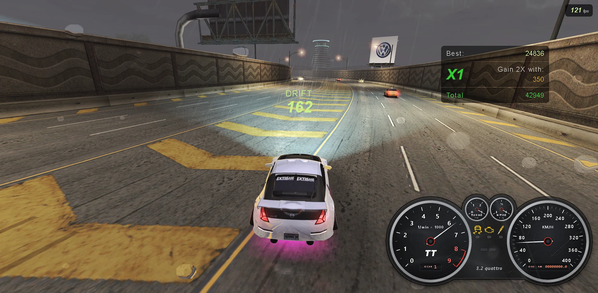
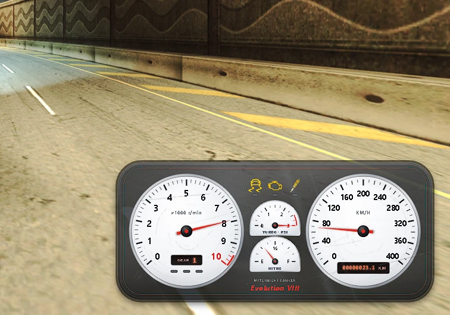
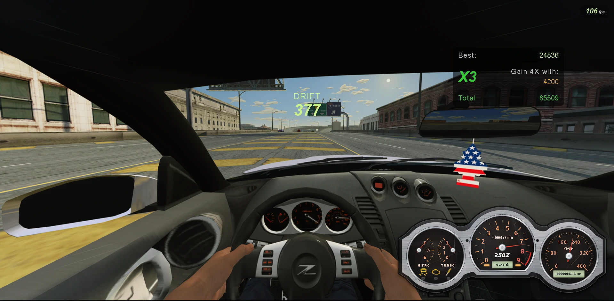
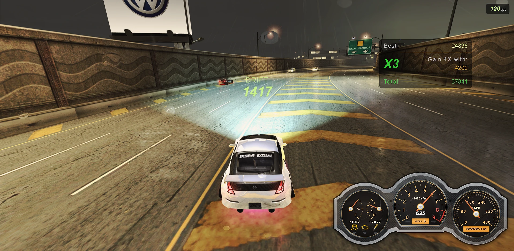
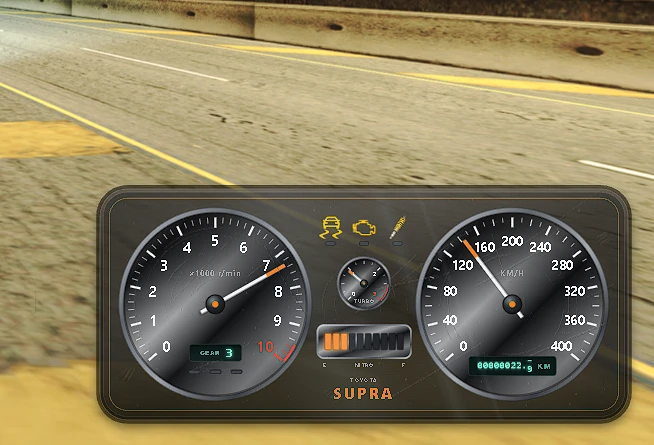
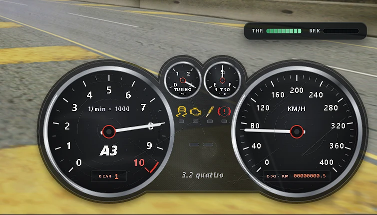
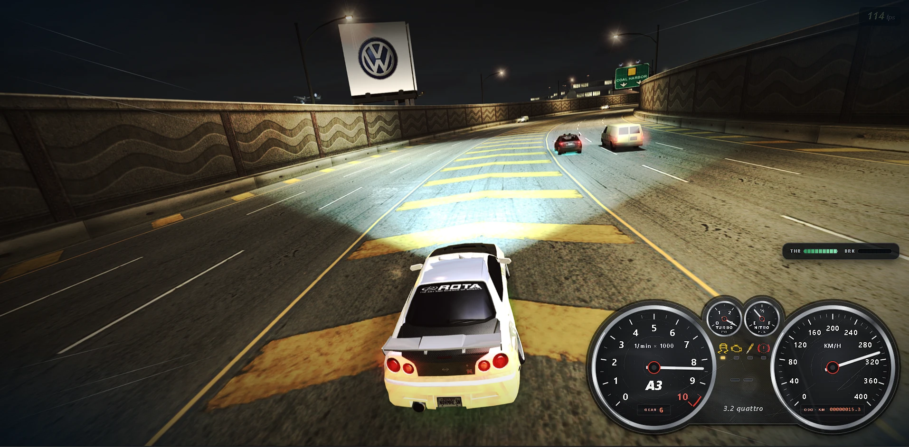

# NFSU2.xyz Modern HUD — v0.10.4

**Major feature release: 9 HUD styles, realistic glass, per-style materials, independent panels and improved collision feedback.**

This public release is a **cumulative update from the previous public GitHub version v0.9.77**. The headline features below were introduced across the development builds leading up to v0.10.3; **v0.10.4 is the packaged release version**. No separate minor-fix section is included.

## Four new HUD styles — nine total

1. **Audi A3 3.2 quattro / Audi TT** — dark analog dials, upper Turbo/Nitro gauges, model-specific badge, needle design, ring finish, GEAR and rolling ODO.
2. **Nissan 350Z / Infiniti G35** — joined contoured cluster; dual Nitro/Turbo dial on the left, central RPM and GEAR, speed/ODO on the right; model-specific materials and amber/green displays.
3. **Mitsubishi Lancer Evolution VIII / Subaru Impreza WRX STi** — Evo white/red gauges or STi blue/gold gauges; center warning indicators, Turbo/Nitro, rolling ODO, GEAR and green shift-ready LEDs.
4. **Toyota Supra (A80) / Mazda RX-8** — recessed twin-gauge housing, model-specific faces; Supra analog instruments or RX-8 built-in digital speed, ten-segment Nitro meter and rolling ODO.

Existing styles remain: **Modern Digital, GT-R Analog, Toyota Corolla Retro, Honda Civic and Mazda RX-7 FD**. The Honda Civic cluster has also been redesigned with an **EP3-inspired** layout, cream dials and revised housing. Vehicle-specific variants are selected automatically from your **manually chosen ODO car model**, or may be overridden in the variant controls.

## Visual design and customization

- **Glass reflection & wear:** adjustable transparent gauge-glass layer and subtle depth effects on analog dashboards.
- **GT-R Housing:** optional fitted background/frame that responds to instrument layout changes.
- **Colors & Materials:** per-analog-style customization for needles, tick marks / numbers, redline, odometer digits and background, frame, dial face and their material appearance; available materials include Original, Matte, Satin, Glossy, Chrome, Brushed Metal, Carbon Fibre and Leather.
- **Needle and display refinements:** more consistent gauge-needle reach, enlarged warning symbols, revised shift/ODO placements and rolling ODO digits across instrument styles.
- **Settings usability:** searchable, categorized settings; configurable HUD size, position, background opacity and per-gauge X/Y offsets.

## Independent Status HUD

A modern standalone panel with **TYRES, ENGINE, SUSPENSION and HANDBRAKE** icons, alert lamps and angular 2026-style accents. It works without the main speedometer.

- Horizontal or vertical layout.
- Independent ON/OFF through `Ctrl + Alt + N` or `Numpad /`.
- Editable panel scale and X/Y position; background opacity; frame/background/active-light colors.
- Lamps use existing warning/signal logic; the handbrake lamp follows `Space` during driving.

## Independent Pedals HUD

A live **Throttle (THR) / Brake (BRK)** overlay with a horizontal or vertical layout, adjustable size, position and colors. Select **Independent**, **Under the speedometer HUD**, or **Inside the Standalone Status HUD**. The under-speedometer layout reserves space for the bars when the dashboard is docked near the bottom edge.

The bars read available throttle/brake telemetry, with an engine-load fallback for throttle; they **only display input** and do not alter the car.

## Handbrake (`Space`) indicator

A fourth warning icon appears in the nine speedometer styles and the Standalone Status HUD. The **lamp lights only while holding Space during active driving**; it clears on pause, loss of window focus or stale Car Feed. It can be hidden using **Show → Handbrake (Space key)**.

This is **keyboard-based**, not a true Car Feed handbrake signal. A wheel/controller handbrake or remapped key is not automatically detected.

## Impact Feedback, HUD Shake and Limp Mode

- **Screen Shake fixed and expanded:** feedback can now visibly shake the active speedometer, Standalone Status HUD and Pedals HUD, including lighter eligible impacts.
- **Customizable Screen Shake:** keep the existing impact/shake controls and optionally enable **Shake even if Windows/browser 'Reduce Motion' is ON**.
- **Impact diagnostics:** the **Last collision** line helps explain when shake was skipped and how many visible HUD elements were affected.
- **Limp Mode independent of the speedometer:** status and simulated damage can continue with the main HUD OFF; warning placement is anchored above the game's default speedometer.
- **Engine Misfire:** 55% of newly triggered cuts last **1.5 seconds**; the remaining 45% keep the original short/random duration distribution. The overall repair duration remains separately configurable.

## Speed Sensation

Optional corner-darkening **Vignette** with an adjustable percentage complements the existing high-speed streak and Blue Fog effects. Performance and visual effect settings remain configurable.

## User screenshots

**All seven screenshots below are supplied by the project owner from real NFSU2.xyz gameplay.** No generated/replacement artwork.

## Installation / upgrading

- [Download Latest — Chromium + Firefox](https://github.com/N0rMal3NNN/NFSU2-Modern-HUD/raw/refs/heads/main/downloads/NFSU2_Modern_HUD_LATEST_MultiBrowser.zip)
- [Choose a version](DOWNLOADS.md) · [Installation instructions](INSTALLATION.md)
- Load `NFSU2-HUD-Chromium/` in Chrome/Edge/Brave/Opera or `NFSU2-HUD-Firefox/` in Firefox.
- When upgrading, **replace files inside your current installed extension folder**. Don't uninstall and load the update from a new directory if you want the old extension identity / local ODO storage to remain accessible.
- Settings JSON exports do **not** contain car mileage. Back up settings and note important mileage before upgrading.

## Notes and limitations

Unofficial read-only Car Feed overlay. Some warnings, turbo/VTEC, impact conditions, speed sensation and odometer measurements are simulations or local estimates, not verified in-game ECU data. Chrome/Firefox availability and real-game performance vary. This release description lists cumulative user-facing changes since the last published v0.9.77 and does not list every development-build adjustment.