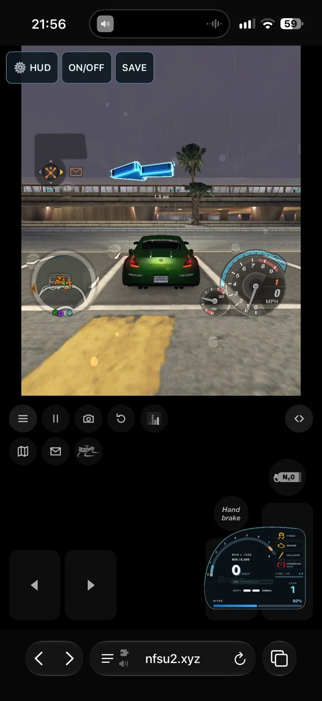
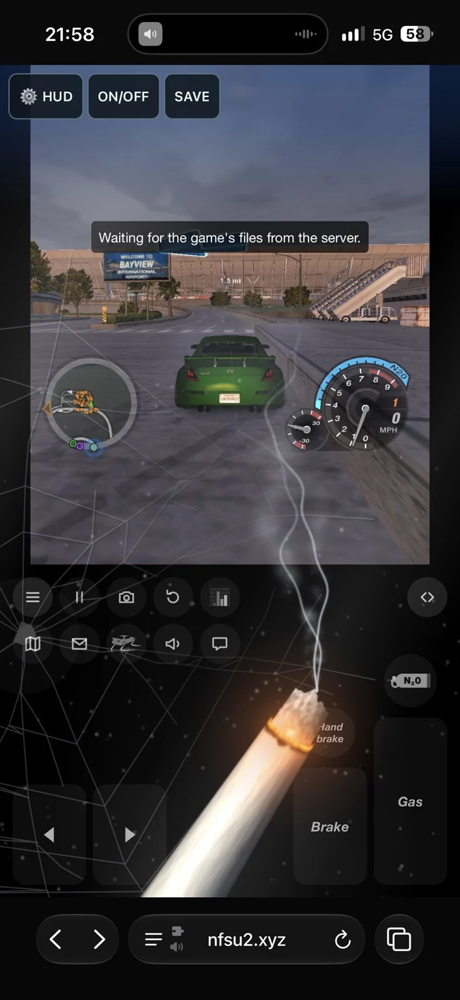

# NFSU2 Modern HUD v0.11.10

## Windshield, HUD Position and Menu Keyboard Update — plus Phone Userscript BETA 4 (iPhone and Android)

This release updates the Chromium desktop extension from v0.11.7 to **v0.11.10** and introduces the first public **Userscript BETA for phones and tablets** — **iPhone** (Safari + Userscripts) and **Android** (Microsoft Edge + Tampermonkey) — built on the same v0.11.10 code.

## 🖥️ Desktop extension — v0.11.8, v0.11.9 and v0.11.10

### v0.11.10 — HUD X/Y Position and Live-Only Status Indicators

- **New: HUD X Position and HUD Y Position** in the main HUD settings. Move the entire speedometer relative to its selected corner with a slider (±1000 px) or type a precise value (px) in the number field.
- **Each HUD style remembers its own X/Y position.** Changing the style does not move the other styles.
- **Reset HUD X/Y Position** button.
- The whole-HUD position is saved with SAVE ALL and included in the settings JSON. It is independent of the existing per-dial offsets and is applied to the outer HUD container, separately from the HUD scale.
- **Standalone Status HUD (TYRES / ENGINE / SUSP):** the panel now appears only while live driving telemetry is arriving. It no longer shows before the game starts sending Car Feed, while the game is paused, or after the feed stops.

### v0.11.9 — Native Menu Keyboard Input

- Typing, selecting, deleting, copy/paste and navigating inside the HUD settings fields (search box, precise number fields, shortcut capture) is now handled by the browser itself while a menu field has focus.
- Game controls and HUD shortcuts no longer interfere while you are typing in the menu.
- `Esc` closes the menu from an edit field.

### v0.11.8 — Independent Windshield Collision Detection

- Windshield cracks now use **their own impact samples and threshold**, independent of Impact Feedback, Helmet, suspension and Limp Mode rules.
- Default *Crack on impacts from* value is now **3.0 m/s** (previously 10.0); the slider range is 3–20 m/s. Existing saved settings are preserved.
- Crack size follows impact strength: medium cracks start at 2× the selected threshold and large cracks at 4×, with up to 5 cracks at once and the clear centre zone protected.
- A conservative sudden-speed-loss fallback is used only when impact telemetry is missing, so ordinary braking, light scrapes and small feed fluctuations do not crack the glass.
- Cracks are not created while the game is paused.

All settings, HUD styles, profiles, cigarette, helmet and odometer data from v0.11.7 are retained.

## Userscript BETA 4 for phones and tablets

**Userscript v0.11.10.4 (BETA 4)** brings the HUD to touch devices through a userscript manager.

| Device | Browser + userscript manager | Status |
|---|---|---|
| iPhone / iPad | **Safari + Userscripts** | Working — tested by the project owner |
| Android | **Microsoft Edge + Tampermonkey** | Working — tested by the project owner and by **RacerXC**, the first Android beta tester |
| Other Android browsers / managers | — | Not tested |

Step-by-step instructions for both platforms: [Phones and tablets: Userscript BETA 4](INSTALLATION.md#phones-and-tablets-userscript-beta-4).

  
  

*iPhone (Safari + Userscripts): the HUD at the bottom right (left) and the Cigarette and Windshield Glass effects (right). These screenshots were supplied by the project owner and come from an earlier BETA build; in BETA 4 only the small ⚙ button is shown until you tap it.*

### What is in BETA 4

- **One small ⚙ button.** The phone screen is not covered by a toolbar.
- **Movable with a finger.** Drag the ⚙ anywhere on the screen. It stays inside the visible area.
- **Remembers its position separately for Portrait and Landscape.** Rotate the phone and the button returns to the place you chose for that orientation. Positions are saved between sessions.
- **HUD, ON/OFF and SAVE stay hidden until you press the ⚙.** Tap it to open the three buttons, tap again (or tap anywhere else) to close them:
  - **HUD** opens the touch-friendly settings menu (the ⚙ hides while the menu is open).
  - **ON/OFF** shows or hides the speedometer. The ⚙ stays available even when the HUD is OFF.
  - **SAVE** saves the HUD settings and odometer.
- **Android support.** The Car Feed connection uses the page window that Tampermonkey exposes, reconnects automatically (at a bounded rate) when the feed goes stale, and rejects messages that do not come from the game page.
- **Android / Car Feed Debug** section in the menu: a local-only diagnostic report (script manager, Car Feed requests and packets, car detected / driving, last error) with **Copy Debug Report** and **Reconnect Car Feed** buttons. Nothing is sent anywhere.
- **Fullscreen overlays.** The HUD, windshield, helmet, cigarette, menu and the ⚙ stay visible when the game goes fullscreen.
- **Windshield cracks limited to 2 on screen by default** (a phone screen is small and fills up quickly). *Windshield Glass → Max cracks on screen* offers **2 (default), 3, 4 or Standard (up to 5)**. When the limit is reached the oldest crack is removed first, and lowering the limit clears the extra cracks immediately. The desktop extension keeps the Standard limit of 5.
- Touch-friendly settings menu; changes apply live and auto-save.
- Smaller, performance-friendly **mobile defaults** (HUD scales and *Eco* performance mode). Everything remains adjustable in the menu; desktop defaults are not changed.

The userscript contains the same v0.11.10 features as the desktop extension (all HUD styles, Standalone Status HUD, Pedals HUD, Limp Mode, Cigarette, Helmet View, Windshield Glass, odometer, impact feedback, Speed Sensation and the v0.11.8 – v0.11.10 changes above).

### Installation in short

- **iPhone / iPad:** install **Userscripts** from the App Store, enable it in *Settings → Safari → Extensions*, put the `.user.js` file into the Userscripts folder, then open `nfsu2.xyz` in **Safari**.
- **Android:** install **Microsoft Edge**, add **Tampermonkey** from *Extensions*, turn on **Enable** and **Allow User Scripts**, then *Tampermonkey Dashboard → Utilities → Import from file* and select the `.user.js` file.
  - If the game fails to start with a WebGPU error, open `edge://flags/#enable-unsafe-webgpu`, set **Unsafe WebGPU Support** to **Enabled** and restart Edge. ⚠️ This is an experimental setting that may affect security and stability; enable it only if necessary.

Full instructions: [Phones and tablets: Userscript BETA 4](INSTALLATION.md#phones-and-tablets-userscript-beta-4).

### Important notes for the BETA

- It is a **beta**. If something does not work, open the HUD settings, use **Android / Car Feed Debug → Copy Debug Report** and send the report together with your phone model, OS/browser version and userscript manager.
- The custom HUD appears only during active gameplay (Free Roam or a race).
- The userscript keeps its **own settings and odometer** in the userscript manager's storage. They are **not shared** with the desktop extension and do not sync between devices.
- Phones have no keyboard: the ⚙ button replaces the keyboard shortcuts.
- Adjust the HUD size and X/Y positions so that the HUD does not overlap the mobile driving controls.
- Cigarette, Helmet View and Windshield Glass remain **OFF by default**; blending effects can reduce FPS on weaker phones — lower them in Settings if needed.
- Phone browsers differ in how they run userscripts and in the performance they offer; live-play results vary by device.

### Thanks

Special thanks to **RacerXC**, the first Android beta tester, for helping to test Android compatibility.

## 🌐 Supported Browsers

Desktop extension (Chromium ZIP): Google Chrome, Microsoft Edge, Brave, Opera, Opera GX, Vivaldi and other compatible Chromium-based desktop browsers.

Phone / tablet userscript (BETA): iPhone / iPad — Safari + Userscripts (working); Android — Microsoft Edge + Tampermonkey (working, tested with RacerXC). Other Android browsers and managers are not tested.

## Download

**[Download v0.11.10 — Chromium ZIP](downloads/NFSU2_Modern_HUD_v0_11_10_Chromium.zip)** — desktop extension

**[Download Userscript BETA 4 — ZIP](downloads/NFSU2_Userscripts_BETA_4.zip)** — phone / tablet userscript ([raw `.user.js`](userscript/NFSU2_Modern_HUD.user.js))

- [Download Latest (Chromium)](https://github.com/N0rMal3NNN/NFSU2-Modern-HUD/raw/refs/heads/main/downloads/NFSU2_Modern_HUD_LATEST_Chromium.zip)
- [Version Archive](DOWNLOADS.md)
- [Installation & Upgrade Guide](INSTALLATION.md)
- [Full Changelog](CHANGELOG.md)

## Important

When upgrading the desktop extension, replace the files inside the existing extension folder and reload the extension to preserve saved settings and mileage.

This is an independent, unofficial NFSU2.xyz community project. Game files and vehicle physics remain unchanged.
