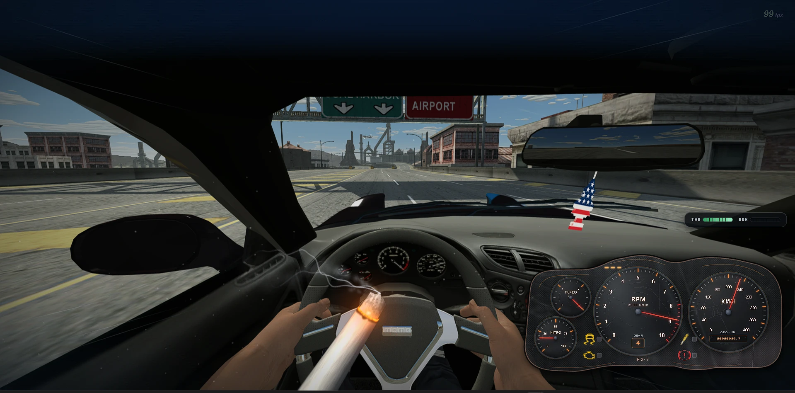
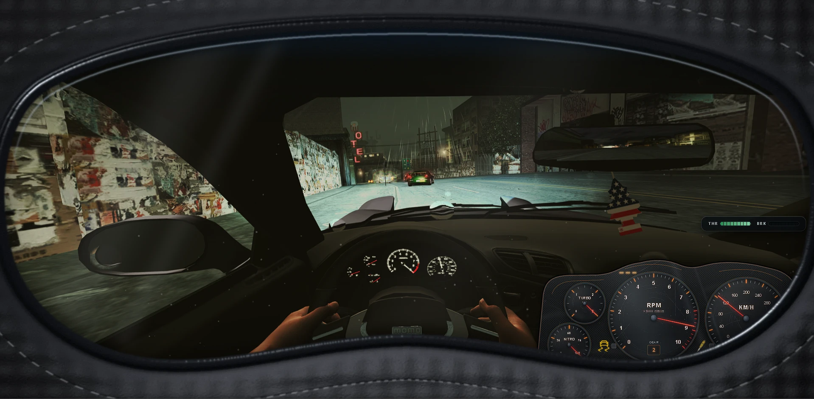

# NFSU2.xyz Modern HUD v0.11.5 — Immersive Cockpit Effects

**Supported:** Google Chrome, Microsoft Edge, Brave, Opera / Opera GX, Vivaldi and compatible Chromium-based desktop browsers.

This public release combines the additions from the v0.10.8–v0.11.4 development builds and introduces a further TYRES warning sensitivity adjustment in v0.11.5. The existing nine car-inspired HUD styles and the independent Status/Pedals HUDs are retained.

## 1. Cigarette — 3D cockpit overlay

Open **Settings → Visual Effects → Cigarette**.

- **Enable Cigarette:** ON/OFF, OFF by default.
- **Position:** bottom-left, bottom-center (default) or bottom-right, mirrored when appropriate.
- **Size:** 50–150%, default 100%.
- **Smoke animation:** ON/OFF, with **Smoke amount 0–100%** (default 60%). Smoke is animated while the cigarette is visible.
- **Ember puff:** optional stronger glow and denser smoke, repeating about every 8–14 seconds.
- **Smoke leans with speed:** optional (OFF by default). Smoke leans farther and becomes shorter at higher speed, returning upright when stopped.
- **In front of the HUD:** choose whether the cigarette sits above or below your custom dashboard and helmet.
- **Preview cigarette:** 7-second test without needing to drive; includes a speed-lean demonstration if enabled.

The cigarette enters from the lower edge of the display, with a textured paper surface, ember and animated smoke. It is **visual only** and does not change driving, game physics or the Car Feed. During normal use it displays only with active driving telemetry and is hidden on pause.

## 2. Helmet View — two models

Open **Settings → Visual Effects → Helmet View**.

- **Helmet model:** **GT Full-Face** (default) or **Open-Face Sport**, a second, open-face model.
- **Enable Helmet View:** ON/OFF (default OFF), with **Opacity 0–100%**.
- **Opening size:** 90–130%, default control value 100%; the rendering was opened up slightly compared with the initial helmet prototype.
- **Helmet in front of the HUD:** choose immersive overlap or leave the full instrument cluster unobstructed.
- **Shake on impact:** ON/OFF (default ON when Helmet View is enabled); separate **Shake intensity 0–100%** (default 50%), with **Preview shake**.
- The effect is designed to allow mouse clicks through and to avoid continuous work while hidden. Shake respects reduced-motion preferences unless the corresponding Impact Feedback override is enabled.

## 3. Windshield Glass — configurable full-screen overlay

Open **Settings → Visual Effects → Windshield Glass**. The effect is OFF by default.

- Independent **Reflection**, **Dust**, **Wiper Marks** and **Sun Strip** controls. Sun Strip supports a custom color.
- **Impact cracks:** strength and minimum-impact threshold; each collision can create line, star or spiderweb patterns, fading after an adjustable delay.
- **Limp shattered glass:** more extensive breakage during Limp Mode, clearing when recovery completes.
- **Visibility protection:** keeps the screen center clearer for driving, plus effect previews and **Clear cracks**.

The windshield layer is positioned below the custom dashboard.

## 4. TYRES — 10% later activation than v0.11.4

Previous threshold from v0.10.8: **slider × 1.05** (+5%). New threshold: **slider × 1.05 × 1.10 = slider × 1.155**.

| Condition | Before (v0.11.4) | Now (v0.11.5) |
|---|---:|---:|
| Standard setting, 3.4 m/s | 3.570 m/s | **3.927 m/s** |
| Extreme one-wheel slip (×1.8) | 6.426 m/s | **7.069 m/s** |

This affects lateral tyre slip, longitudinal wheelspin and extreme one-wheel slip across all HUD styles, including the Standalone Status HUD. The existing sustained-slip delay, minimum-speed gate, normal BRAKE and estimated ABS behavior are unchanged. Users can still adjust the original **Wheel slip warning** slider.

## Compatibility and installation

The package contains **only** `NFSU2-HUD-Chromium/`. It is an unpacked Chromium desktop extension. To keep your settings and local odometer, replace the files **inside the same installed extension folder**, reload that extension, then refresh NFSU2.xyz. A fresh installation in a new folder or profile may not recover the previous extension's stored mileage; profile JSON exports do not contain mileage.

- [Download Latest](https://github.com/N0rMal3NNN/NFSU2-Modern-HUD/raw/refs/heads/main/downloads/NFSU2_Modern_HUD_LATEST_Chromium.zip)
- [Choose Version](DOWNLOADS.md)
- [Installation and upgrade guide](INSTALLATION.md)

**Testing note:** The archive and JavaScript syntax were checked. The updated slip threshold was checked against boundary test cases. Live gameplay and all supported browsers have not been exhaustively verified; results can vary with game updates and telemetry.

This is an **unofficial fan-made visual extension** not affiliated with NFSU2.xyz.