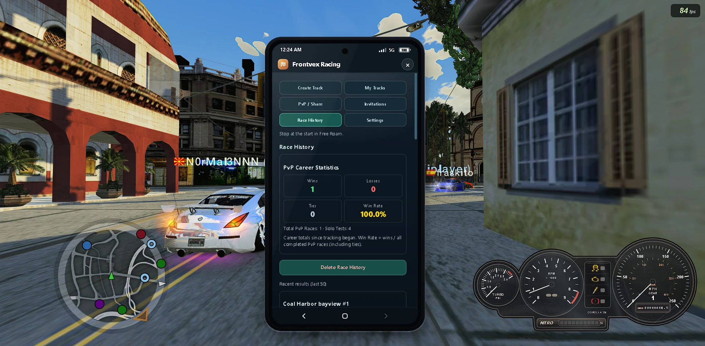
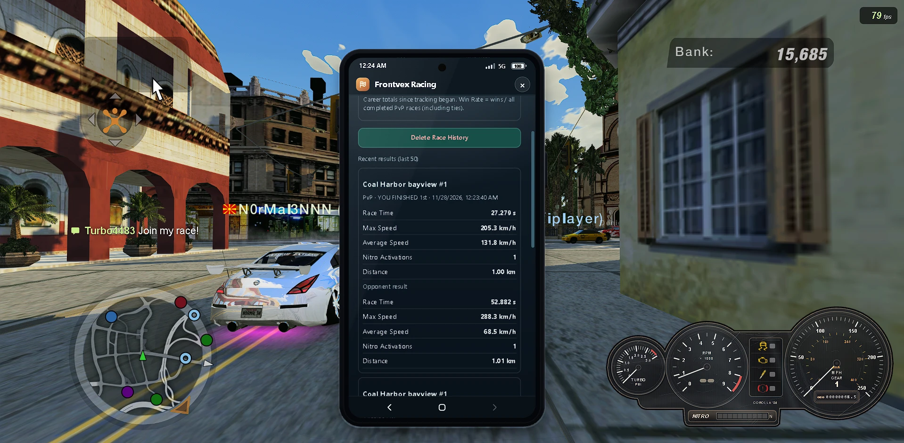
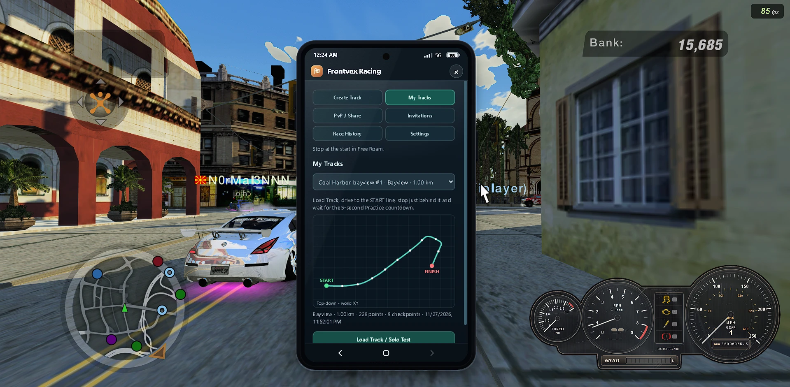
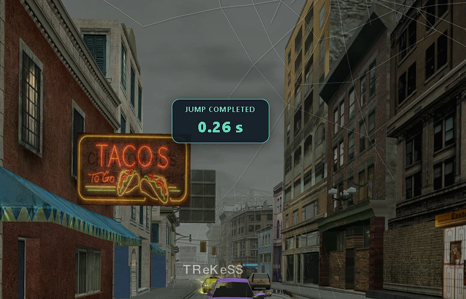
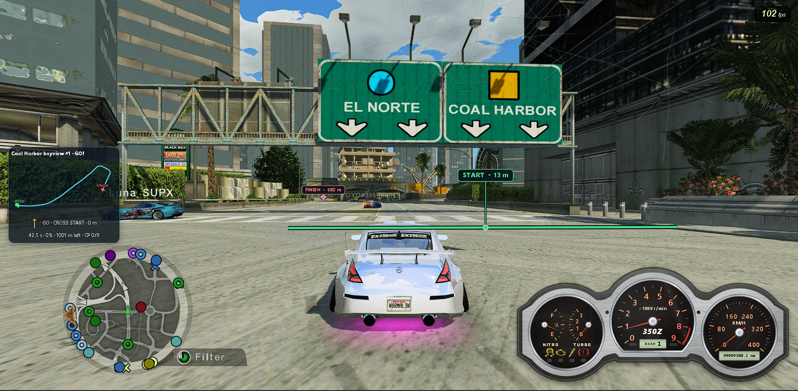

# v0.11.66 BETA — Frontvex Racing & My Car

A cumulative desktop update since v0.11.60. Create and share your own Free Roam race tracks, challenge a Frontvex friend to a 1v1, or test your car with real Car Feed telemetry.

## Frontvex Racing

- Record named custom routes from the car's 3D coordinates, with start and finish gates and sequential checkpoints.
- My Tracks: preview, save, load, delete, and share routes with registered online friends. Accept and save a shared track before challenging its owner.
- Solo Test: practice your own route with automatic countdown and finish statistics.
- PvP 1v1: race invitations, notifications, automatic route loading, live opponent marker and position, synchronized countdown, and direct WebRTC communication.
- Both drivers must be staged behind START, stationary for two seconds, and within 5 m of each other (side by side, one behind the other, or diagonally) for the automatic PvP countdown. Both need this desktop version.
- Green START, white checkpoint and red FINISH lines (24 m wide). Optional 3D pins, adjustable checkpoint opacity, height and visibility range.
- Configurable Racing overlay above the original minimap, predictive turn arrow, next-turn distance, progress, race timer, colors, size, opacity and position.
- Burnouts during the countdown are permitted; crossing START early is a false start.
- Finish HUD: gold first place (including Solo Test), silver second place, race time, maximum and average speed, distance and nitrous activations.
- Local Race History stores the latest 50 detailed results, while cumulative wins, losses, ties, Solo Tests and win rate are stored separately. Delete Race History includes confirmation.
- Optional bilateral Pause Test Mode for testing on a single PC; leave it disabled for normal races.

### How to start a PvP 1v1 race

1. **Register and connect:** Both players need the latest public desktop extension (v0.11.66 for this release), a registered Frontvex account/number and enabled communication. Enter Free Roam and make sure both players are online and can connect directly.
2. **Add a friend:** Open the Frontvex phone → **Contacts**, find your friend by their Frontvex number, send a friend request and have them accept it.
3. **Create a track:** Open **Racing → Create Track**, enter a track name, choose **Set START & Record**, drive the route, choose **Set FINISH**, and press **Save Track**.
4. **Share the track:** In **My Tracks**, select the saved track, select your online friend and send it using **Share Race Track**.
5. **Accept the shared track:** Your friend opens **Racing → Invitations**, previews the route and selects **Accept & Save Track**. Wait for the sender to receive confirmation that the track has been saved. If the recipient deletes the track, share it again.
6. **Challenge your friend:** With the same track and friend selected, press **Challenge Friend**. This is a separate PvP invitation; sharing the track alone does not start a race.
7. **Accept the race:** Your friend receives a Racing notification (sound/pop-up subject to notification settings), opens **Invitations**, and presses **Accept Challenge**. The race route, Racing HUD and enabled 3D markers load automatically for both players.
8. **Stage at START:** Both cars must be behind the green START line, within the staging zone, facing along the route, stationary and **no more than 5 metres apart in 3D** (side by side, one behind the other, or diagonally).
9. **Get ready automatically:** Remain stationary for **2 uninterrupted seconds**. Once both players are ready, within range and synchronized, the countdown starts automatically: **5 – 4 – 3 – 2 – 1 – GO!** No manual Ready or Start Countdown button is needed.
10. **Race and finish:** Follow the route, cross the white checkpoints in order, then cross the red FINISH line. The finish HUD shows your placement, race time, maximum and average speed, nitrous activations and distance. Results are saved in **Race History**.

**Race rules:** Burnouts using SPACE + W are allowed during the countdown, but crossing START before GO triggers a false start. Leave **Enable Start With Pause (Test Mode)** disabled for normal races. Keep the game active and the P2P connection working. A successful direct connection is required; cross-network PvP remains a beta feature. Solo Tests do not count as PvP wins or losses.

## My Car

- Performance Monitor: start a test, accelerate and come to a stop to save 0–100, 0–200, 100–200 km/h, quarter-mile, top-speed and braking-distance measurements where completed.
- Latest Result and Personal Best per supported car identity; nitrous use is detected automatically. Turbo installation is selected manually, since the feed does not expose this upgrade.
- Driving Statistics: trip distance, driving time, maximum and average speed, gear shifts, nitrous activations, impacts and jump statistics.
- Independent trip and statistics reset controls; existing odometer and performance records remain separate.
- Optional Jump Monitor displays airborne time and holds the completed jump result for four seconds.

## Screenshots

The following screenshots show the preceding tested development build with the same Racing and Jump Monitor interface. 

### PvP Career Statistics

### Race results

### My Tracks

### Jump Monitor

### Racing overlay and 3D start/finish markers

## Compatibility and privacy

The extension uses the official read-only Car Feed and View Feed. Race routes, history and car statistics are stored locally. PvP exchanges race data directly with a friend when the WebRTC connection succeeds; it is a friendly racing system, not a server-verified competitive leaderboard. No production server update is required. Cross-network PvP still needs real-world testing. Mobile Userscript BETA 5 remains available separately.

Special thanks to [OBD Gaming](https://www.facebook.com/overbudgetgg) for the inspiration behind the Frontvex in-game phone. Your idea helped bring this feature to life!
