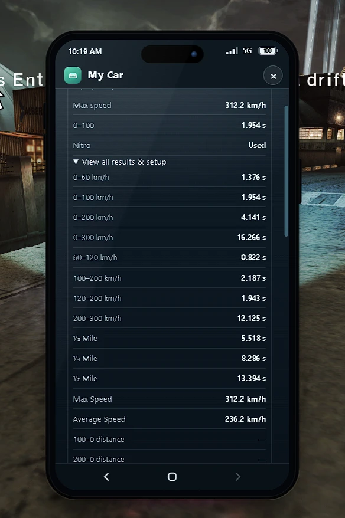
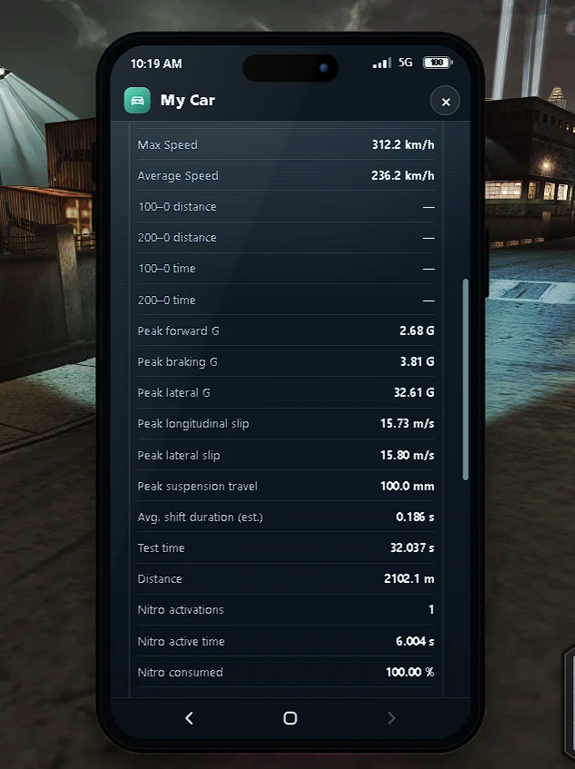
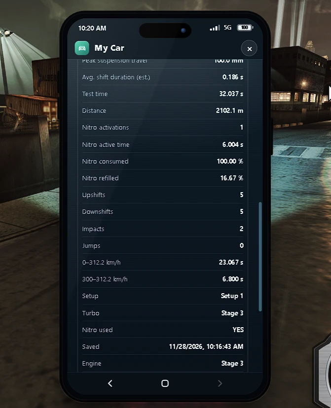
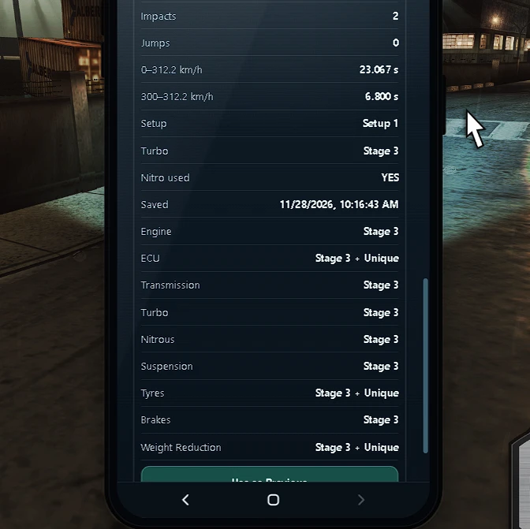

# v0.11.68–v0.11.69 BETA — My Car Performance Lab

A cumulative desktop update since v0.11.67. Configure your current car, measure its performance using the official read-only Car Feed, then compare tests before and after installing upgrades.

## Car Setup

- Save a named setup per supported vehicle identity (Car ID for owned cars).
- Record all nine upgrade categories: Engine, ECU, Transmission, Turbo, Nitrous, Suspension, Tyres, Brakes and Weight Reduction.
- Select Stock, Stage 1–3, Custom or Unknown, with a separate Unique flag per part.
- Select 0, 1 or 2 nitrous bottles. The app displays the remaining amount as a percentage and records measured depletion and refills separately.
- Each test saves an independent snapshot of the setup, so changing an upgrade does not overwrite the previous test configuration.

## Performance Test

- Full Performance, Acceleration, Braking and Handling test categories collect the available telemetry.
- Start while stationary; recording begins when driving forward. Finish manually or stop for one second to save automatically. The default finish shortcut is Ctrl + Alt + F (configurable).
- Acceleration intervals: 0–60, 0–100, 0–200, 0–300, 60–120, 100–200, 120–200 and 200–300 km/h.
- No fixed 300 km/h finish threshold. The result includes maximum achieved speed, time from zero to that peak, and 300 km/h to peak when reached.
- Measure 1/8, 1/4 and 1/2 mile times, maximum and average speed, test duration and distance.
- Braking distance/time from 100 and 200 km/h when completed, peak forward/braking/lateral G, wheel slip, suspension travel, estimated shift duration, shifts, impacts and jumps.
- Nitro activations, active time, consumed and refilled amounts relative to selected capacity.
- Uncompleted measurements remain blank rather than displaying invented results.

## Compare Results & Test History

- Compare two saved tests and all nine upgrade categories, including Unique flags.
- View measured differences in acceleration, speed, braking and other available metrics, and an overlaid speed-versus-time graph.
- Compare like-for-like conditions: route, weather, surface, transmission mode and nitrous use. Impact, jump and slope warnings help identify unsuitable comparison runs.
- Turbo PSI, nitrous pressure, actual engine horsepower and torque are not supplied by the Car Feed. Performance changes are measured from the tests, not inferred as actual pressure or power figures. Multiple changed parts are treated as an overall setup change.
- Up to 50 detailed tests per vehicle identity, personal records and history deletion with confirmation. Existing odometer and driving statistics remain separate.

### How to find the best upgrades for your car

You can run multiple performance tests, save your results, compare any two saved runs, and discover which upgrades or combinations of parts give your car the best measured performance.

For example, start with Engine Stage 2, ECU Stage 2, Turbo Stage 2 and your existing tyres, suspension and other parts. Save this configuration as your baseline and complete a performance test. Install Engine Stage 3 in the game, update that part in Car Setup and run another test on the same road under similar conditions. Compare both runs to see how the upgrade affected acceleration, maximum achieved speed, braking and other measured results. Repeat with ECU, Turbo, Transmission, Tyres, Suspension, Brakes, Nitrous or Weight Reduction to evaluate different builds.

| Example metric | Before upgrade | After upgrade | Difference |
|---|---:|---:|---:|
| 0–100 km/h | 5.000 s | 4.500 s | 10% less time |
| 100–200 km/h | 10.000 s | 9.000 s | 10% less time |
| Maximum achieved speed | 310 km/h | 325 km/h | +15 km/h |
| 100–0 km/h braking distance | 40 m | 38 m | 5% shorter |

*Illustrative values, not measured results from a real upgrade test.*

Every recorded test retains its complete nine-part setup, including Unique upgrades. Compare Results shows the two setups, the measured differences and the acceleration curves. You can revisit older tests from Test History instead of losing them when you modify your car. Up to 50 detailed tests can be stored per vehicle identity.

For a fair comparison, use the same car, route, direction, transmission mode, weather and nitrous conditions. Run each setup several times and avoid collisions or jumps. Changing one part at a time makes it easier to evaluate that upgrade; if several parts change together, the difference represents the overall setup rather than the contribution of any single part. Tyres, brakes and suspension may improve traction, braking or cornering without increasing top speed. Turbo boost pressure, nitrous pressure, horsepower and torque are not directly exposed by the feed, so the app compares observed performance instead of inventing sensor readings.

## Shared Performance Tests & Friend Comparison (v0.11.69)

**Available in the public v0.11.69 desktop release.** Both players need v0.11.69 or newer and an active Frontvex connection.

Share saved performance tests directly with online Frontvex friends, including all nine upgrade categories, Unique flags, measured results, test conditions and speed graphs. Recipients can accept or decline, store up to 50 shared tests separately, and compare a received result against any of their saved tests, including different car models. Positive/negative differences highlight measured gains or losses; results are not server-verified.

### How to share and compare

1. Open My Car → Test History and expand **Share Performance Test** on a saved result.
2. Select an online friend and press **Share Test**.
3. The recipient receives a notification and opens My Car → **Shared Tests** to accept and save or decline the result.
4. Select **Compare With My Setup** and choose one of your saved tests. Compare the complete setup, acceleration, speed, braking, handling, nitrous, events and speed curves side by side.

The friend's username appears above their car. Comparison tables display **Friend** by default and reveal the username on hover without moving the statistics. Long names are truncated to fit. Test-condition warnings help identify unfair comparisons.

Shared data uses the existing direct peer-to-peer connection; no odometer, personal Car ID or route coordinates are included. Shared test results are not verified by the server. The public FVX ID is masked by default, can be revealed manually for ten seconds, and can still be copied. The mask helps prevent accidental disclosure in screenshots.

Live cross-network sharing has not yet been independently verified.

## Performance HUD Settings

Independent of the main speedometer: X/Y position, size (20–250%), opacity, preview and reset. Settings are saved locally across cars.

| Display mode | During test | After completion |
|---|---|---|
| Live Test + Results | Visible | 10 seconds |
| Results Only | Hidden | 10 seconds |
| Hidden / OFF | Hidden | Hidden |

## Quick start

1. Open My Car → Car Setup, enter the installed upgrades and save the setup.
2. Stop the car, open Performance Test and press Run Test.
3. Drive the test route. Stop for one second or press Ctrl + Alt + F to finish.
4. Install an upgrade in the game, update Car Setup and run another test under comparable conditions.
5. Open Compare Results or Test History to select two recorded tests.
6. Customize the overlay in My Car → HUD Settings.

## Live game example

A recorded run reached **312.2 km/h**, with 0–100 km/h in **1.954 s**, 0–200 in **4.141 s**, 0–300 in **16.266 s**, and 0–312.2 in **23.067 s**. It recorded 2,102.1 m over 32.037 s. This example used nitrous and includes two impacts; it is a demonstration of recording, not a controlled upgrade benchmark. Impact-related acceleration spikes can affect peak G readings.

### Screenshots

Four screenshots from the tested v0.11.68.2 development build:
#### Acceleration and distance results

#### Braking and driving telemetry

#### Nitro and dynamic peak-speed intervals

#### Saved upgrade configuration

## Compatibility and privacy

Desktop Chromium public release; mobile Userscript BETA 5 is unchanged. Performance Lab uses local storage and the official read-only Car Feed. Local tests require no additional Frontvex server requests; optional sharing in v0.11.69 uses the existing friend connection. It does not change the game's upgrades or physics. For best results compare repeated runs on the same route with the same driving conditions. The example confirms live result recording; not every mode has been independently verified in the live game.

[Installation & Update Guide](INSTALLATION.md) · [PvP Racing Guide](RELEASE_NOTES_v0.11.66.md#how-to-start-a-pvp-1v1-race)
