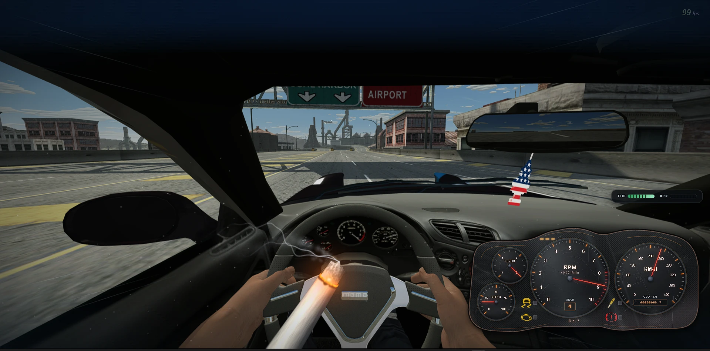
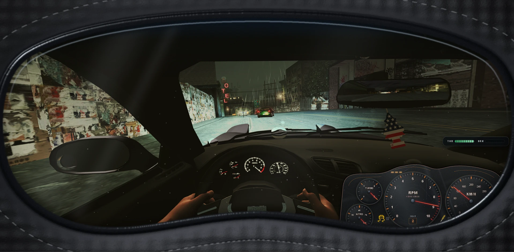

# NFSU2 Modern HUD v0.11.7

## Cigarette, Helmet & Driving Immersion Update

This update combines customizable cockpit effects with improved tyre slip detection for a more immersive driving experience in NFSU2.xyz.

## 🚬 Cigarette

- Enable / Disable.
- Glowing ember, ash and animated smoke.
- Three selectable positions: Left, Center and Right.
- Adjustable size (50–150%).
- Adjustable smoke intensity (0–100%).
- Smoke Animation ON/OFF.
- Automatic Ember Puff effect.
- Dynamic smoke movement based on vehicle speed.
- Placement in front of or behind the HUD.
- 7-second preview.
- Disabled by default.

## 🏁 Helmet View — 2 Helmet Models

Two selectable helmet models:

- GT Full-Face Helmet
- Open-Face Sport Helmet

Customization options:

- Helmet ON/OFF.
- Adjustable helmet opacity (0–100%).
- Adjustable visor opening size (90–130%).
- Placement in front of or behind the HUD.
- Shake on Impact ON/OFF.
- Adjustable shake intensity (0–100%).
- Helmet shake preview.
- Automatically hidden when the game is paused.
- Disabled by default.

## 🚘 Windshield Glass

- Customizable reflections.
- Adjustable dust intensity.
- Customizable wiper marks.
- Adjustable sun strip with custom colors.
- Three different windshield crack patterns.
- Dynamic windshield cracks after collisions.
- Shattered windshield during Limp Mode.
- Automatic crack fading.
- Central visibility protection.
- Independent visual effect controls.
- Disabled by default.

## 🔧 Fixed: SLIP Light

- Reworked tyre slip detection using Car Feed telemetry.
- Fixed false SLIP Light activation during sharp cornering without actual tyre slip.
- Improved lateral slip detection.
- Improved wheel spin detection.
- Improved wheel-to-ground contact detection.
- Improved filtering of temporary slip signals.
- Increased slip detection threshold.
- Retained the 550 ms detection confirmation time.
- Added real-time tyre slip telemetry diagnostics.
- ABS and braking detection remain unchanged.
- Improvements apply to all HUD styles and Standalone Status HUD.

## 🌐 Supported Browsers

- Google Chrome
- Microsoft Edge
- Brave
- Opera
- Opera GX
- Vivaldi

## Download

**[Download v0.11.7 — Chromium ZIP](downloads/NFSU2_Modern_HUD_v0_11_7_Chromium.zip)**

- [Download Latest](https://github.com/N0rMal3NNN/NFSU2-Modern-HUD/raw/refs/heads/main/downloads/NFSU2_Modern_HUD_LATEST_Chromium.zip)
- [Version Archive](DOWNLOADS.md)
- [Installation & Upgrade Guide](INSTALLATION.md)
- [Full Changelog](CHANGELOG.md)

## Important

All visual effects are optional and customizable.

Existing HUD styles, settings, profiles and odometer functionality are retained.

When upgrading, replace the files inside the existing extension folder and reload the extension to preserve saved settings and mileage.

This is an independent, unofficial NFSU2.xyz community project. Game files and vehicle physics remain unchanged.

Enjoy a more immersive driving experience in NFSU2.xyz!
