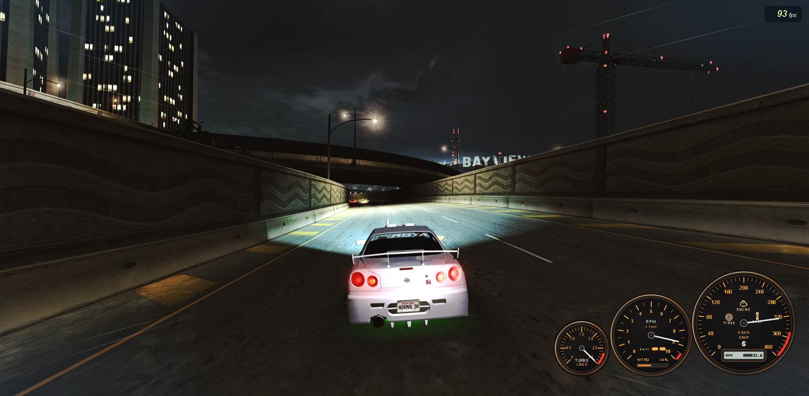
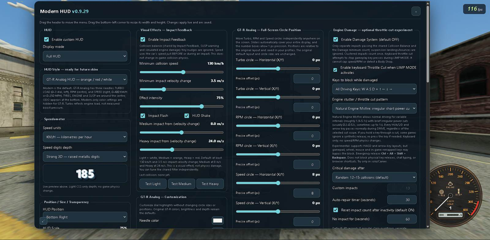
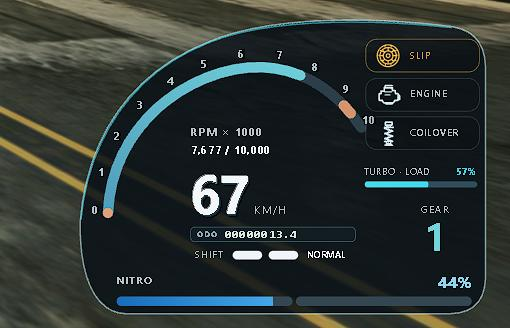

# NFSU2 Modern HUD v0.9.31 — Major Update

**Update from v0.9.9 • Modern + GT-R Analog • Chromium-based desktop browsers**

The largest Modern HUD update since the first public release. This release rolls up all additions, improvements and fixes from **v0.9.10 through v0.9.31**.

## New features

- **Speed Sensation** — cylindrical/tunnel peripheral streaks with adjustable start speed (**190 km/h by default**), intensity, preview and a separately controlled **Blue Fog (12% default, 0–100% adjustable)**.
- **Impact Feedback** — configurable white/orange/red collision flashes, optional HUD-only shake, impact thresholds and in-menu previews.
- **Improved SUSP and collision detection** — filters small bumps, default minimum collision speed **130 km/h**, and detects some severe instant stops even when collision telemetry is missing.
- **Limp Mode defaults** — **30 s Repair Timer** and **60 s No Impact Timer**.
- **GT-R Analog 400 KM/H / 250 MPH**, original gauge geometry retained, each dial individually movable across the screen.
- **GT-R Analog Customization** — needle/number/tick colors, illumination/depth, refined TYRES/ENGINE/SUSP vector icons and their new positions.
- **Per-car Odometer (ODO)** — independent mileage for **31 manually selected car models**, 100-metre resolution, LCD in both HUD styles, **autosave every 100 m**, maximum **9,999,999.9 km**.
- **Numpad `*` Quick Save** — save all HUD settings and mileage without opening Settings.
- **Responsive Settings Menu** — resizable with 1–4 columns, stable control sizes, saved placement.
- **Modern HUD layout fix** — more balanced spacing between RPM, Speed, ODO and SHIFT, less unused right-hand space, and 1 px digit spacing on both odometers.

## Notable fixes

- Fixed false Heavy/RED feedback from small impacts; repaired the previously ineffective HUD Shake.
- Fixed missed SUSP warnings and added a conservative crash fallback for 220→0 km/h stops.
- Fixed odometer totals/model selection not reliably surviving browser restart.
- Fixed ODO menu showing 4.9 while HUD showed 4.8 due to mismatched rounding.
- Fixed false “Save incomplete — retry” when mileage changed while saving.
- Improved Speed Sensation FPS by replacing heavy filters with lightweight animation.

## Installation / upgrade

1. Download the **v0.9.31 Chromium ZIP** attached to this release.
2. Extract it and choose `NFSU2-HUD-Chromium` (Chrome/Edge/Brave/Opera/Vivaldi).
3. **If updating**, replace the files inside the **same folder used by your existing installed extension** and reload the existing extension. Installing from a different unpacked folder may change the extension ID and hide your old locally stored ODO data.
4. Refresh NFSU2.xyz. Press **Numpad +** for Settings, choose the car model in **Odometer — Mileage by Car**, and use **Numpad `*`** for Save All.

See [INSTALLATION.md](https://github.com/N0rMal3NNN/NFSU2-Modern-HUD/blob/main/INSTALLATION.md) for details.

## Important notes

- Odometer distance is **estimated and stored only in this browser extension**, not in the game's save. Mileage is **by car model**, not individual owned car. Settings JSON profiles **do not contain mileage**.
- The game exposes limited read-only telemetry: some damage, impact and other indicators are approximations, not official mechanical readings.
- Testing is based primarily on local/simulated telemetry. Please report real-game behavior and FPS problems.

**Unofficial fan project; not affiliated with or endorsed by NFSU2.xyz.**

## Screenshots

