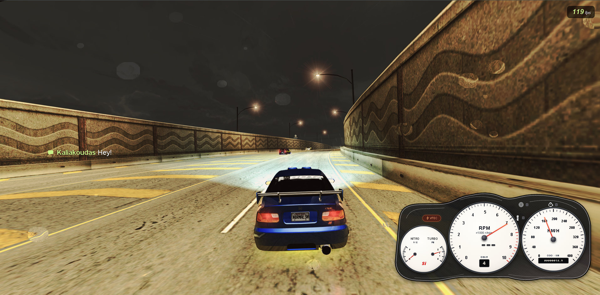
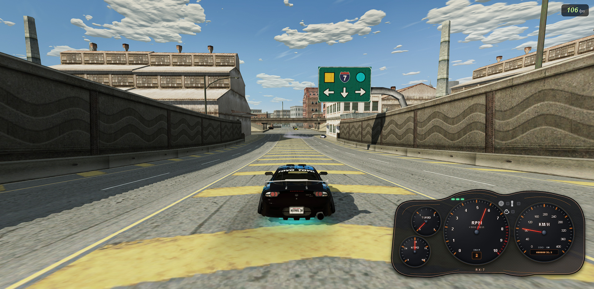

# NFSU2.xyz Modern HUD v0.9.77 — 3 New Analog HUDs + Custom Keyboard Shortcuts

> **Five-HUD feature overview and installation guide**

This update expands NFSU2 Modern HUD from **two HUD styles to five**, introducing dedicated Toyota Corolla, Honda Civic Si and Mazda RX-7 dashboards alongside the existing Modern and GT-R Analog HUDs.

## Three brand-new HUD styles

### Toyota Corolla Retro (AE86-inspired)
- Classic retro instrument cluster with a distinctive connected dashboard frame.
- Analog RPM and speedometer with a dual-scale retro presentation.
- Mechanical **GEAR rolling-number animation**.
- Smooth, digit-by-digit **ODO roll** from bottom to top.
- Integrated TYRES, ENGINE and SUSP status indicators and adjustable instrument layout.

### Honda Civic Si (EM1-inspired)
- New carbon dashboard with bright ivory-faced RPM and speed instruments.
- A dedicated **dual-needle Nitro / Turbo analog gauge**.
- **VTEC indicator**: RPM-based simulation activating at 5,600 RPM and releasing below 5,500 RPM.
- Three shift LEDs with amber near-shift and green shift-ready states.
- Integrated TYRES, ENGINE and SUSP indicators.
- Mechanical GEAR display and smooth rolling ODO digits.
- Independent gauge sizing, placement and background opacity.

### Mazda RX-7 FD
- New asymmetric carbon instrument housing with red, white and orange details.
- Independent analog Turbo and Nitro gauges, central RPM and right-hand speedometer.
- **KM/H by default**, with an optional separate MPH speedometer scale in settings.
- Rolling GEAR, compact ODO, green shift guidance and integrated status lamps.
- Independent X/Y positioning and sizing for Turbo, Nitro, RPM and Speed.

## New customization and usability features

- **Five selectable HUD styles**: Modern, GT-R Analog, Corolla Retro, Civic Si and RX-7.
- **Zero-based dial positioning**: the factory calibrated position now reads **X: 0 px / Y: 0 px** for each analog HUD. Existing saved layouts are migrated so their visual positions are preserved.
- **Expanded HUD Scale** controls, allowing custom percentages beyond the old 70–100% range.
- **Per-skin gauge controls** for circle size and precise X/Y offset, while keeping the different HUD styles' settings independent.
- **New rolling GEAR animation** on the existing GT-R Analog HUD and in the new analog clusters.
- **Rolling ODO digits** in the new Honda and Corolla HUD styles.
- **Car-to-HUD assignments**: link a HUD style to a selected car model through the ODO menu; later selection of that model restores its assigned HUD style.

## New: Custom Keyboard Shortcuts & TKL support

No numeric keypad? You can now customize the extension's controls on **TKL (tenkeyless) keyboards**, laptops and full-size keyboards.

- **Rebind all three HUD actions**: Open/Close Menu, Toggle HUD ON/OFF, and **SAVE ALL** (settings + local car mileage).
- **Change shortcuts inside the HUD settings menu or browser extension popup**.
- Press **Change**, then press your preferred key or combination. Letter/number shortcuts require **Ctrl or Alt** so ordinary game driving/chat keys are not accidentally intercepted.
- **Ctrl + Alt + M** is a built-in **backup shortcut to open/close the HUD menu**, available even if you don't have a Numpad or have customized the normal menu binding.
- **Reset Shortcuts to Defaults** restores the original assignments without resetting HUD layout or mileage.
- Custom bindings are saved and included in **SAVE ALL / Export Settings JSON**.

| Action | Original default | Additional TKL shortcut |
| --- | --- | --- |
| Open / close HUD menu | `Numpad +` | **`Ctrl + Alt + M` (always available backup)** |
| Toggle HUD ON / OFF | `Numpad −` | User-configurable |
| SAVE ALL (HUD + ODO) | `Numpad *` | User-configurable |

*The Numpad defaults remain unchanged unless you explicitly rebind them. Ctrl + Alt + M is reserved for the menu and cannot be assigned to other HUD actions.*

## Settings Menu Compatibility with Strict CSP

- **Fixed HUD settings/menu rendering** on pages with strict Content Security Policy (CSP), where extension-owned styles could previously be blocked and leave parts of the menu unstyled or difficult to use.
- The settings UI now restores its styles through browser-compatible Shadow DOM stylesheets and DOM style properties; the draggable/resizable panel works in Chromium-family browsers.
- **Chromium browser and TKL keyboard users** retain the same HUD controls, saved profiles and local ODO behavior.

## Improvements to existing HUD styles (v0.9.31 → v0.9.73)

### Modern HUD
- Corrected the rightmost **RPM '10' label** so it no longer overlaps the COILOVER warning panel.
- Kept text/number opacity customization specific to Modern HUD.

### GT-R Analog
- Added rolling GEAR-number animation.
- Improved compatibility with the new zero-based position defaults and wider HUD scaling controls.

### Settings and compatibility
- Improved import/migration of older JSON layout profiles without shifting previously saved gauges.
- Kept existing per-car odometer data, Car Feed functionality, saved profiles and original Numpad defaults; added optional custom shortcuts without removing those defaults by default.
- The Chromium-compatible desktop browser build remains available.

## Real in-game screenshots

### Honda Civic Si

### Mazda RX-7 FD

*Screenshots supplied by the project owner from gameplay. The v0.9.73 factory-coordinate changes were checked in Chromium; Final build should be checked on the owner's game setup.*

## Installation / upgrade

1. [Download the **v0.9.73 Chromium ZIP**](downloads/NFSU2_Modern_HUD_v0.9.77_Chromium.zip) and extract it.
2. Use `NFSU2-HUD-Chromium/` for Chrome, Edge, Brave or Opera.
3. For an existing installation, replace the files **inside the same installed extension folder**, reload the extension, and refresh NFSU2.xyz. Back up/export your settings first.
4. Keep your existing extension storage so saved settings and model-specific mileage remain accessible.

**Important:** ODO mileage is estimated and stored locally by car model. VTEC and Turbo PSI are simulations based on available Car Feed values; they are not direct mechanical sensor measurements. This is an unofficial independent fan project.

